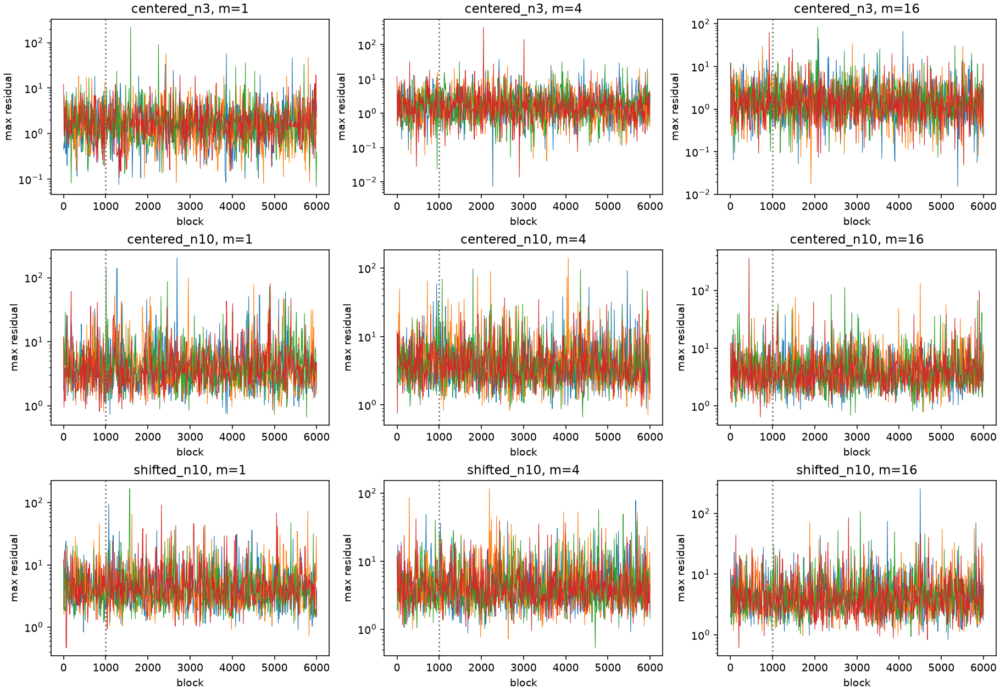

# Cheaper selected-MLE Gibbs: reversible blocks and direct simulation

Date: 2026-10-10. Scope: unit-scale Student location, k=2, n=3 and n=10.

**Outcome:** a separate compiled, random-scan score-block prototype has a justified selected-MLE endpoint correction on regular strata. All nine bounded case/block-length combinations pass the declared posterior and latent-mixing screens. Blocks take approximately **82–137 microseconds**, with approximately **one global-selector call per accepted block**. The literal legacy numerical kernel cannot be declared exact and wrapped with W alone: its support strip, derivative floor, and proposal approximations require attention. Existing samplers were left unchanged.

**Practical conclusion:** direct prior rejection is the cheapest tested way to obtain independent joint posterior samples in the two centered cases. Weighted Monte Carlo remains the canonical selected-MLE reference, including the shifted case. The new block sampler is competitive for shifted-prior latent-tail expectations, with length 16 giving about 3,343 tail-indicator ESS/sec versus an estimated 1,486 equivalent samples/sec for fresh weighted Monte Carlo. This is a functional and case-specific advantage, not general MCMC superiority.

## 1. Sources and the legacy-pair audit

Read and traced the [target audit](selected_mle_target_audit.md), [selector hardening](selected_mle_selector_hardening.md), [Gibbs validation](student_selected_mle_gibbs_validation.md), [RATTLE validation](student_selected_mle_rattle_validation.md), and [shifted reference follow-up](shifted_student_reference_followup.md). The actual compiled legacy pair path is `update_pairs` in [loc_student.py](../../models/loc/student/score_gibbs.py), called by its compiled Gibbs driver. Branch weights, truncated-normal sampling, and the parameter update were inspected directly.

**Derivation, ideal regular pair.** Hold mu and all other observations fixed. Put y=x-t, psi(y)=y/(k+y²), z_i=psi(y_i), delta=z_i+z_j, b=1/(2 sqrt(k)), L=max(-b,delta-b), U=min(b,delta+b). For nonzero z in (-b,b), the two finite inverse branches are

\[
y_{\mathrm{in}}(z)=\frac{2kz}{1+\sqrt{1-4kz^2}},\qquad
y_{\mathrm{out}}(z)=\frac{1+\sqrt{1-4kz^2}}{2z}.
\]

At z=0 the only finite inverse is zero; folds are chart boundaries. Define

\[
w_\mu(z,B)=\frac{f_k(t+y_B(z)-\mu)}{|\psi'(y_B(z))|},\quad
q_\mu(z)=\sum_B w_\mu(z,B),\quad Q(z)=q_\mu(z)q_\mu(\delta-z).
\]

Changing the pair to score coordinates and integrating its score constraint gives density w_i w_j dz, without a further arc-length factor. Its score marginal is Q, and its conditional branch probability is p(B|z)=w_i w_j/Q, with B denoting both branches.

The legacy algorithm's idealized procedure first performs scalar MH for Q with an interval-truncated Gaussian h(z'|z), then refreshes **both branches at the resulting score, including after a scalar MH rejection**. The scalar log ratio is

\[
\log Q(z')-\log Q(z)+\log Z(z)-\log Z(z'),\qquad
Z(z)=\Phi((U-z)/\sigma_z)-\Phi((L-z)/\sigma_z).
\]

Let M be that reversible marginal-score MH kernel. The full pair kernel is

\[
K((z,B),d(z',B'))=M(z,dz')p(B'|z').
\]

Its joint flux is Q(z)p(B|z)M(z,dz')p(B'|z'), symmetric by reversibility of M. This includes the diagonal-in-score rejection part. **Branch refresh after scalar rejection is correct for this score-target kernel.** It would be wrong to refresh branches after rejection of the later selected-MLE outer block.

**Inspection, numerical qualifications.** The literal legacy implementation differs from the ideal procedure:

- `EPS_Z=1e-12` removes an open strip next to each physical score fold; inverse reconstruction also clips to this strip.
- `log_psi_prime_abs` uses `abs(k-y*y)+1e-30`, changing the inverse-Jacobian weight. The two returned zeros at z=0 are counted twice in q, whereas there is one finite inverse.
- The truncated-normal draw uses an approximate inverse CDF, a probability clamp `EPS_U=1e-12`, and output clipping. Its implemented pushforward law is not precisely the Gaussian density assumed by its Hastings calculation; fallback can return a clipped center.
- Scalar MH acceptance also floors its uniform variate. Several unresolved numerical values become silent stays or branch fallbacks.

Even replacing the legacy quantile draw by an ideal exact draw would leave a truncated, derivative-regularized base target, rather than the full score target. In that hypothetical version, the regularization contributes factors |k-y_i²|/(|k-y_i²|+1e-30), and excluded support cannot be recovered by W. This is not an exact characterization of the entire literal kernel, whose quantile/clamping law has additional issues. Ordinary outputs may differ negligibly, but **W alone does not establish the desired invariant distribution for unchanged literal legacy code**.

**Sweep qualification.** An arbitrary composition of overlapping reversible pair kernels need not be reversible. However, the actual ideal legacy x-sweep uses a state-independent permutation and disjoint pairs, with mu fixed. Those ideal score-pair kernels commute because they act on disjoint coordinates and preserve their own pair sums; their product and permutation mixture are reversible. The full sweep including a parameter update is not automatically a reversible x-proposal. The prototype below uses random-scan powers, whose proof also permits overlapping pairs and arbitrary declared block length.

## 2. Reversible block and one endpoint correction

**Derivation.** Relative to the score-conditioned manifold target rho_C=F_mu/sqrt(G), the regular selected-MLE target is rho_T=rho_C W, where

\[
G=\sum_i\psi'(x_i-t)^2,\qquad
W(x)=\mathbf1\{T(x)=t\}\left|\sum_i\psi'(x_i-t)\right|.
\]

T is the hardened selected global likelihood maximizer, with the smaller location selected only for exact likelihood ties. At a regular selected maximum J=sum psi'>0. Positive J alone does not establish global selection.

Choose an ordered pair uniformly from n(n-1) possibilities at each inner step, independently of x and of previous choices. The mixture K of ideal pair kernels is self-adjoint with respect to rho_C. For a **fixed, state-independent** block length m, K^m is also self-adjoint. Holding mu fixed throughout, propose x' from K^m and accept the **entire** dataset with min(1,W(x')/W(x)). Its accepted flux is

\[
\rho_C(dx)K^m(x,dx')\min\{W(x),W(x')\},
\]

which is symmetric. No block proposal density must be evaluated, and the score-density terms already belong to the inner reversible kernels. Intermediate positions may be MLE-invalid: selection is target support at the endpoint, not an additional inner constraint. A failed outer test restores every coordinate and branch in the block.

**Evaluation order.** Compute endpoint score/Gram/curvature and log J'-log J. Resolved negative curvature implies zero selected-MLE support. For positive resolved curvature, draw one uniform and test the cheap J ratio first. Invoke the global selector only if that test passes; then accept only if the selected MLE is t. There is no second MH draw. The current selected state is cached with its dataset/release/shape/scale token. Zero or ambiguous curvature, unresolved arithmetic, and selector failure raise rather than becoming support rejections.

W is independent of mu, so the ordinary parameter conditional remains prior(mu)F_mu(x). The existing parameter MH update is reused unchanged. Alternating this invariant parameter block and the corrected x-block preserves the joint target; the full chain need not be reversible.

## 3. Separate prototype and numerical failure repair

New implementation: [loc_student_selected_mle_block.py](../../models/loc/student/selected_block.py). It reuses compiled legacy psi and truncated-normal normalizers, tested floor-free branch log weights from transparent corrected Gibbs, the existing parameter MH update, and checked selected-state/geometry helpers from selected-MLE RATTLE. It calls no RATTLE trajectory. Existing Gibbs, RATTLE, affine acceptance, selector, KDE, registries, and location-scale code were not edited.

The new Numba pair routine implements the ideal marginal-score MH followed by branch refresh, with physical open intervals, both finite inverse branches, a singleton finite zero branch, no derivative floor, no score-strip clipping, and explicit reconstruction/nonfinite checks. Independent NumPy and Numba RNG streams come from a recorded `SeedSequence`; repeated runs reset the Numba thread-local stream. Independent chain seeds give different chains without changing Python's global NumPy RNG. Concurrent same-thread interleaving of unfinished runs is not an advertised interface.

**Preserved failed first batch.** The first version sampled a truncated Gaussian only by rejection from an untruncated Gaussian. After 20 completed chains, centered n=10, m=16, chain 0 exhausted its 10,000-draw limit at block 3,709, inner pair step 6. A bounded deterministic replay identified interval width 5.27259e-5 at sigma_z=0.1, giving acceptance probability 0.000210346. Exhausting 10,000 trials there has probability about 0.122, so this was an inefficient near-fold proposal sampler, not an MLE-selection failure or evidence of divergence. Its exception, precise state/interval, code/configuration snapshots, logs, and all completed arrays are retained in [v1 evidence](evidence/cheap_selected_mle_gibbs_2026-10-10/v1/). The original failed chain's full partial trajectory was not saved; the replay saved its failing intermediate state. The prototype now attaches completed partial arrays and failure iteration to block exceptions, and the driver saves them.

**Repair, same proposal law.** For interval width below sigma_z, sample uniformly on the interval and accept with exp(-(z-center)²/(2 sigma_z²)). Because center is inside the interval, this is valid rejection sampling for exactly the same truncated Gaussian h. Its acceptance is at least exp(-1/2). Wider intervals retain ordinary Gaussian rejection, with probability at least Phi(1)-1/2. Both are bounded by 10,000 attempts and raise on exhaustion. No Hastings formula, step size, block lengths, initializers, seeds, stopping criteria, or reference screens changed. One fresh complete batch was run with the repaired implementation; none of its 36 chains failed.

**Limits of the claim.** The proof is exact-arithmetic, regular-region mathematics. The unchanged parameter MH uniform guard at 1e-12 remains an inherited approximation. Floating inverse/CDF calculations, the small initial score residual preserved by pair moves, and selected-state release tolerances are not universal numerical certification. Singular estimator strata, unresolved global ties, extreme inputs outside the tested domain, and global irreducibility remain outside the validation claim. Gram/curvature guards abort rather than define a silently truncated sampling target.

## 4. Checks, frozen experiment, and reference provenance

New [focused tests](../../tests/test_student_selected_mle_block.py) check analytic inverse-Jacobian probabilities, all joint branch flux combinations, rejection-time branch refresh, Hastings signs, random-scan powers versus a nonreversible composition, the narrow/wide truncated-normal law, whole-block rollback, cheap rejection, injected selector and sampling failures, partial failure records, reproducibility, independence, score preservation, and global selection. The repaired combined suite passed **105 tests in 11.10 s**; one subsequently added failure-context regression passed **1 test in 4.49 s**. Thus **106 focused checks passed across two final commands**, with no final timeout or collection failure. An initial test fixture used a score outside the k=3 physical range; that fixture was corrected. The subsequent batch failure above was preserved and repaired separately.

Rational-oracle checks passed for **36 initializers, 180 retained datasets, 216 proposed endpoints, and 18 fresh direct-simulation datasets: 450 checks total**. For the 432 MCMC/initializer checks, maximum selector/oracle location difference was 5.02e-16, likelihood gap 4.44e-15, and score at the selected root 5.56e-16. Maximum oracle displacement from the release on checked valid datasets was 2.10e-14. Runtime maxima across all repaired chains were score residual 1.71e-14 and cached selected-MLE/release difference 1.08e-13. There were **zero selector failures or high-precision fallbacks** in this batch or the fresh direct cost banks. These checks do not certify every uninspected proposal.

The [frozen configuration](evidence/cheap_selected_mle_gibbs_2026-10-10/config.json) declares exactly m=1,4,16; four dispersed chains per setting; 6,000 blocks per chain; burn-in 1,000; and 20,000 pooled retained states per setting. All k=2, known scale=1:

- Centered n=3: release 0, prior N(0,2²).
- Centered n=10: release 0, prior N(0,2²).
- Shifted n=10: release 1.25, prior N(-0.75,0.6²).

Initial datasets match the fixed corrected-Gibbs validation: low/median/high reference latent maxima and a normalized negative-outlier configuration. No all-at-release initialization. sigma_z=0.1, sigma_mu=0.45. Chain seeds are case base 2026103200/2026113200/2026123200 plus 100m+chain index. Each chain has a 180-second ceiling. The repaired batch used 216,000 blocks and 1,512,000 inner pair attempts in 23.10 serial chain-seconds. Import/JIT setup, oracle work, plotting, and serialization are excluded from chain throughput; burn-in is included in ESS/sec denominators. Failed first-batch work and diagnostic replay are additional, explicitly archived work.

Preflight rechecks existing raw-reference hashes, the hardened selector hash, all reference summaries, and fixed Gibbs arrays. Reference bootstrap uncertainty is **carried forward unchanged**, not regenerated or replaced by a KDE. Centered n=3 uses 32,768 particles (weight ESS 32,009); n=10 uses the previously validated two 65,536-particle standardized banks. Shifted weight ESS is 14,747. [Reference provenance](evidence/cheap_selected_mle_gibbs_2026-10-10/reference_provenance.json) links original evidence and hashes. The new 4,096-particle direct pilots are throughput diagnostics, not replacement references.

Screens were fixed before execution: rank R-hat <=1.01 and bulk/tail ESS >=400 for mu, maximum residual, and its >6 indicator; each posterior and latent summary difference <=4 combined MCSE. MCMC uncertainty is the larger of 250-block batch and four-chain MCSE diagnostics. Correlated KS/Wasserstein distances are descriptive, not independent-sample significance tests. The rare shifted event mu>2 is excluded from normal-uncertainty screens; zero observations do not imply zero error.

## 5. Posterior and latent comparisons

All nine settings pass those finite-run screens. Maximum R-hat is 1.00760; minimum bulk ESS is about 1,036 and minimum tail ESS about 1,091. The largest summary discrepancy is 2.96 combined MCSE. This establishes bounded agreement, not high-precision convergence or irreducibility.

| Case | m | Mean | SD | q05 | q50 | q95 |
| --- | --- | --- | --- | --- | --- | --- |
| Centered n=3 | Reference | -0.0034 | 0.7711 | -1.2441 | -0.0096 | 1.2378 |
| Centered n=3 | 1 | 0.0058 | 0.7570 | -1.2115 | -0.0119 | 1.2640 |
| Centered n=3 | 4 | -0.0083 | 0.7511 | -1.1909 | -0.0141 | 1.2079 |
| Centered n=3 | 16 | -0.0030 | 0.7236 | -1.2000 | 0.0008 | 1.1546 |
| Centered n=10 | Reference | -0.0012 | 0.4205 | -0.6855 | -0.0003 | 0.6839 |
| Centered n=10 | 1 | -0.0024 | 0.4145 | -0.6718 | 0.0018 | 0.6631 |
| Centered n=10 | 4 | -0.0073 | 0.4356 | -0.7261 | -0.0028 | 0.7007 |
| Centered n=10 | 16 | 0.0040 | 0.4179 | -0.6631 | -0.0052 | 0.7106 |
| Shifted n=10 | Reference | 0.4931 | 0.4386 | -0.2650 | 0.5297 | 1.1469 |
| Shifted n=10 | 1 | 0.5086 | 0.4242 | -0.2249 | 0.5402 | 1.1406 |
| Shifted n=10 | 4 | 0.5008 | 0.4238 | -0.2476 | 0.5386 | 1.1256 |
| Shifted n=10 | 16 | 0.4949 | 0.4309 | -0.2646 | 0.5320 | 1.1287 |

Maximum residual M=max_i |X_i-t| and tail-6 probability:

| Case | m | M q50 | M q90 | M q95 | P(M>6) ± MCSE |
| --- | --- | --- | --- | --- | --- |
| Centered n=3 | Reference | 1.468 | 4.818 | 6.977 | 0.06688 ± 0.00136 |
| Centered n=3 | 1 | 1.527 | 4.659 | 6.904 | 0.06530 ± 0.00317 |
| Centered n=3 | 4 | 1.497 | 4.768 | 6.896 | 0.06630 ± 0.00209 |
| Centered n=3 | 16 | 1.439 | 4.636 | 6.894 | 0.06380 ± 0.00240 |
| Centered n=10 | Reference | 3.600 | 9.673 | 13.800 | 0.23440 ± 0.00109 |
| Centered n=10 | 1 | 3.618 | 10.015 | 14.836 | 0.23640 ± 0.01055 |
| Centered n=10 | 4 | 3.565 | 9.575 | 13.660 | 0.22725 ± 0.00494 |
| Centered n=10 | 16 | 3.605 | 9.521 | 13.562 | 0.23185 ± 0.00344 |
| Shifted n=10 | Reference | 3.954 | 10.349 | 14.680 | 0.26925 ± 0.00389 |
| Shifted n=10 | 1 | 3.923 | 10.304 | 14.980 | 0.26135 ± 0.01018 |
| Shifted n=10 | 4 | 3.905 | 10.786 | 15.443 | 0.26035 ± 0.01217 |
| Shifted n=10 | 16 | 3.902 | 10.201 | 14.746 | 0.26020 ± 0.00422 |

The shifted m=16 mean is 0.49486 ±0.01771 versus reference 0.49314 ±0.00530; its tail-6 estimate is 0.26020 ±0.00422 versus 0.26925 ±0.00389. These are diagnostic one-standard-error uncertainties, not equal-precision estimates. At n=3, m=16's SD estimate 0.7236 is visibly below reference 0.7711 but within the declared uncertainty screen; more accurate parameter estimation is not established by these short runs. Full per-chain and split summaries, all posterior tails, quantile MCSEs, and KS/Wasserstein distances are in [comparisons.json](evidence/cheap_selected_mle_gibbs_2026-10-10/comparisons.json) and [summary.csv](evidence/cheap_selected_mle_gibbs_2026-10-10/summary.csv).

## 6. Runtime, selection calls, and latent movement

| Case | m | µs/block | Outer accept | Selector calls/accepted block | Selector µs/accepted block | Total µs/accepted block |
| --- | --- | --- | --- | --- | --- | --- |
| Centered n=3 | 1 | 81.7 | 85.14% | 1.0029 | 57.0 | 96.0 |
| Centered n=3 | 4 | 83.1 | 79.36% | 1.0035 | 57.8 | 104.7 |
| Centered n=3 | 16 | 101.1 | 76.60% | 1.0031 | 59.6 | 132.0 |
| Centered n=10 | 1 | 100.1 | 94.72% | 1.0000 | 69.6 | 105.7 |
| Centered n=10 | 4 | 109.0 | 89.64% | 1.0001 | 75.6 | 121.6 |
| Centered n=10 | 16 | 127.9 | 86.14% | 1.0000 | 77.6 | 148.4 |
| Shifted n=10 | 1 | 104.6 | 93.68% | 1.0003 | 73.9 | 111.6 |
| Shifted n=10 | 4 | 118.0 | 88.02% | 1.0006 | 83.5 | 134.0 |
| Shifted n=10 | 16 | 137.0 | 83.12% | 1.0012 | 86.1 | 164.8 |

Selector calls per accepted block exclude four initialization checks per setting. Acceptance counts include unchanged endpoint proposals. Selector time is measured around the endpoint check; block time includes parameter updates, bookkeeping, and rejected blocks. Internal proposed branch changes can undo each other, so their count is not a count of net retained branch transitions.

| Case | m | Largest R-hat | Mu bulk ESS/sec | M bulk ESS/sec | Tail-6 ESS/sec | Longest tail-6 episode (blocks) |
| --- | --- | --- | --- | --- | --- | --- |
| Centered n=3 | 1 | 1.00439 | 546 | 2255 | 3693 | 11 |
| Centered n=3 | 4 | 1.00760 | 575 | 3356 | 6918 | 7 |
| Centered n=3 | 16 | 1.00268 | 427 | 3034 | 5454 | 8 |
| Centered n=10 | 1 | 1.00307 | 1027 | 706 | 719 | 46 |
| Centered n=10 | 4 | 1.00571 | 844 | 2647 | 2720 | 17 |
| Centered n=10 | 16 | 1.00194 | 758 | 3875 | 4492 | 8 |
| Shifted n=10 | 1 | 1.00599 | 478 | 750 | 761 | 47 |
| Shifted n=10 | 4 | 1.00253 | 698 | 1763 | 1839 | 22 |
| Shifted n=10 | 16 | 1.00289 | 645 | 3036 | 3343 | 12 |

Length 4 gives the highest tested n=3 latent-tail ESS/sec; length 16 gives the highest tested n=10 latent-tail ESS/sec. Increasing block length modestly lowers outer acceptance but improves latent transport at n=10. The retained tail episodes and multiple large-residual excursions provide joint exploration evidence beyond posterior means. They do not prove communication among every topological component or convergence of far-tail moments.



**Fixed comparisons, not reruns.** Historical transparent corrected-Gibbs bulk ESS/sec (mu, maximum, tail-6) were approximately (154,676,829), (71,252,209), and (49,187,209). Historical corrected-RATTLE values were (201,136,72), (500,13,19), and (353,22,36). Its two n=10 joint-target comparisons failed latent mixing; the new block chains pass the same style of screens and have much shorter retained tail episodes. Historical shifted affine chains also had weak latent exploration (maximum-residual R-hat about 1.078, bulk ESS about 54). None was rerun or retuned here.

Transparent Gibbs recorded approximately 268 microseconds/sweep at n=3 and 1,335/1,377 at centered/shifted n=10; historical affine proposals were approximately 250/312 microseconds. These are fixed historical measurements, with different transitions and work per iteration. They are **not matched fresh wall-time speedup measurements**. The new prototype combines endpoint batching, compiled pair orchestration, and a different reversible score/branch composition from transparent joint-pair MH. Its cost reduction cannot be attributed to selector savings alone. The actual matched fresh comparison in this task is among the three new block lengths and the direct-generation pilot below.

## 7. Direct simulation: identity and measured cost

**Derivation, same selected-MLE identity.** Draw standardized E iid from the location-zero model and let A=T(E). Translation equivariance gives T(mu+E)=mu+A. Conditioning this on release t and integrating over mu yields

\[
\mu=t-A,\qquad X=\mu+E,\qquad
dP(E\mid T(X)=t)\propto \pi_0(t-T(E))\,dP_0(E).
\]

The delta integration is in mu with derivative one; there is **no extra curvature/J weight** in this construction. Global selection is essential in A; an arbitrary score root does not define the same statistic.

Raw weighted MC uses weights pi_0(t-A), normalized by their sum for posterior expectations. Prior rejection accepts with pi_0(t-A)/sup pi_0; for the normal prior this is exp(-0.5((mu-prior_mean)/prior_std)²). Accepted pairs (mu,X) are independent joint posterior draws under the identity and accurate selected-MLE calculations. Affine rejection and weighting implement the same identity; constrained MCMC is not required to construct the location-only posterior.

The new pilot uses one fresh 4,096-dataset bank per n, seeded 2026103500+n, with a 60-second ceiling each. All MLE calculations succeeded. The two n=10 priors share the standardized bank; cost below charges the full bank afresh to each comparison rather than assuming free cache generation. The warmed single-core measurements include drawing E, selecting A, reconstruction, weighting, and rejection uniforms; import/JIT and file output are excluded. Rejection acceptance intervals are exact binomial 95% intervals conditional on the implemented identity. Predicted acceptance and weight/functional efficiencies use the larger validated banks to reduce pilot-rate noise; they remain estimates.

| Case | µs/proposal | Accepted/N | Observed acceptance (95% CI) | Predicted independent pairs/sec | Weight ESS/sec | Mean-equivalent samples/sec | Tail-6-equivalent samples/sec |
| --- | --- | --- | --- | --- | --- | --- | --- |
| Centered n=3 | 52.0 | 3748/4096 | 91.50% (90.61–92.34) | 17579 | 18785 | 23334 | 19209 |
| Centered n=10 | 68.5 | 4001/4096 | 97.68% (97.17–98.12) | 14268 | 14578 | 15429 | 14602 |
| Shifted n=10 | 68.4 | 99/4096 | 2.42% (1.97–2.93) | 318 | 1645 | 793 | 1486 |

For a functional h, normalized reference weights a_i estimate SNIS variance by sum a_i²(h_i-hbar)². Dividing posterior Var(h) by that estimate gives an equivalent iid sample count for that **particular expectation**. For tail-6 use h=1{M>6}. For the mean use h=mu. Dividing by particle count and measured generation cost estimates fresh-reference equivalent samples/sec. This quantity can exceed particle count for an efficiently chosen importance proposal; it is not literal iid output or universal weight ESS. MCMC mean comparison should use raw mu ESS rather than rank bulk ESS: shifted block m=4/16 gives about 679/608 raw-mean ESS/sec, against about 793 mean-equivalent samples/sec for weighted MC. For the shifted tail indicator m=16 gives about 3,343 ESS/sec, against about 1,486 for weighted MC and 318 independent accepted pairs/sec for prior rejection.

The shifted pilot's weight ESS is only 471 and it produces 99 accepted independent pairs; it cannot independently resolve all posterior tails or replace the validated reference. Existing standardized banks can be reweighted for new priors/releases very cheaply. Amortizing that cache further favors weighting, but resampling a fixed weighted bank does not create new independent information. Acceptance and efficiency for other priors may change substantially.

## 8. Recommendation, evidence, and reproduction

**Cheapest justified options:** use direct prior rejection for independent centered joint samples; use raw weighted selected-MLE MC as the canonical reference and for portable posterior summaries; retain the new reversible-block prototype when shifted-prior latent functionals or fresh joint trajectories justify MCMC. Length 4 at n=3 and length 16 at n=10 are useful next candidates within this tested set, not universally optimal settings. The transparent corrected Gibbs remains the inspectable cross-check. No sampler registry or production default was changed.

**Ready for further development?** Yes, narrowly: the regular-block derivation, explicit numerical failures, and bounded posterior/latent results justify focused development of this separate prototype. They do not justify wrapping the literal legacy kernel unchanged, discarding direct references, claiming numerical certification over all inputs, resolving the rare shifted mu>2 event, or beginning RATTLE tail optimization/general cleanup. This task stops here.

Evidence: [configuration](evidence/cheap_selected_mle_gibbs_2026-10-10/config.json), [comparison arrays and diagnostics](evidence/cheap_selected_mle_gibbs_2026-10-10/comparisons.json), [direct comparison](evidence/cheap_selected_mle_gibbs_2026-10-10/direct_comparison.json), [oracle records](evidence/cheap_selected_mle_gibbs_2026-10-10/oracle_checks.json), [preservation check](evidence/cheap_selected_mle_gibbs_2026-10-10/preservation_check.json), and [artifact manifest](evidence/cheap_selected_mle_gibbs_2026-10-10/artifact_manifest.json). All **673 pre-existing inventoried files** retained their bytes. Bulky new arrays remain in ignored `tmp/cheap_selected_mle_gibbs_20261010_v2/`; failed-version completed arrays remain in `tmp/cheap_selected_mle_gibbs_20261010/`. Provenance files record seeds, initial datasets, selector/source/config hashes, raw paths and array hashes. The raw paths are local artifacts and must accompany the manifest for a portable handoff; plotting images and compact tables alone cannot regenerate chains.

Driver: [validate_cheap_selected_mle_gibbs.py](../../scripts/validate_cheap_selected_mle_gibbs.py). From the repository root, recompute analysis of saved arrays without extending chains:

```bash
PYTHONPATH=/tmp/student-mle-oracle-deps-20261003 .venv/bin/python scripts/validate_cheap_selected_mle_gibbs.py --config docs/research/evidence/cheap_selected_mle_gibbs_2026-10-10/config.json --phase analyze
```

For a fresh reproduction, copy the configuration to a new dedicated study location, change **only** raw/evidence output directories to fresh paths, and run phases `pilot`, `chains`, `analyze`, `direct` in that order with the same environment. The driver refuses to overwrite existing chain/direct bank arrays. Supply SymPy (installed in the above supplemental path in this environment) for the independent rational oracle, and preserve the linked baseline/reference artifacts. Focused checks:

```bash
PYTHONPATH=/tmp/student-mle-oracle-deps-20261003 PYTEST_DISABLE_PLUGIN_AUTOLOAD=1 timeout 360s .venv/bin/python -m pytest tests/test_student_selected_mle_block.py tests/test_student_selected_mle_gibbs.py tests/test_student_inverse_branch_weights.py tests/test_student_location_mle_hardening.py -q --assert=plain
```

The command now includes the added failure-context regression; reported 105+1 results above identify the actually executed final checks. No broad repository test run or new experiment grid was performed.
