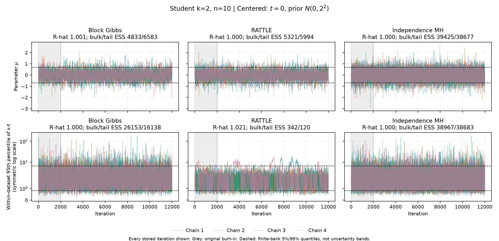
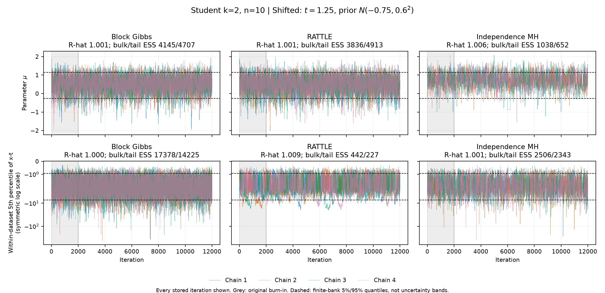

# Location-only inference: collaborator review note

12 October 2026 · For discussion with Christian Robert and Antoine.

This is the current technical account of the known-scale location work. It explains
the target, the implemented corrections, and the evidence needed to judge them.
It replaces the earlier smoke-study brief at this path. The previous version is
preserved in the [document snapshot](evidence/location_review_handoff_2026-10-12/documents_before.tar.gz).
The [LaTeX manuscript](../paper/paper.tex) remains an earlier draft; its results
and figures have not been brought up to this review's scope.

## 1. Where we stand

We infer a location parameter from a released **selected global MLE**. Student-t
is the main model. Logistic and Laplace are comparators. Scale is known.

We have corrected the statistical target and implemented several valid kernels
on their stated regular domains. We also have independent simulation references.
These are distinct achievements from demonstrating good mixing. The latest saved
chains show that a sound RATTLE acceptance rule can coexist with slow latent-data
exploration. Agreement of parameter means is not sufficient validation.

| Method | Current evidence and use |
|---|---|
| Student corrected pair Gibbs | Transparent correctness baseline; earlier reference checks pass. Expensive; outside the latest timing comparison. |
| Student reversible-block Gibbs | All three latest cases pass reference and expanded latent checks. Practical constrained method, especially for shifted-prior latent tails. |
| Student selected RATTLE | Corrected regular-region target. All three latest cases have reference or latent-mixing warnings. |
| Student independence MH | All three latest cases pass bulk and 5%/95% checks. Shifted case is slower and has limited outer-1% precision. |
| Logistic block Gibbs / RATTLE | Block passes three cases, one borderline. RATTLE passes only one of three expanded checks; labelled observations mix slowly at n=10. |
| Laplace median Gibbs / facet HMC | Both pass all four tested cases. Gibbs is faster; direct simulation is cheaper still. |
| Affine sampler | Valid location-equivariance construction with prior validation. Recorded shifted-case latent-mixing problems; not retimed in this study. |
| Raw weighted MC / prior rejection | Independent reference construction / independent posterior draws. Efficiency depends on prior overlap. |

“Pass” refers to finite, declared checks, not universal convergence. Legacy score
samplers remain separate comparators. Joint location-scale methods are still
experimental; `models/scale/` is a placeholder. The [model guide](../../models/README.md)
identifies current imports and legacy aliases.

## 2. The distribution we condition on

Let \(F_\mu(x)=\prod_i f_0(x_i-\mu)\), let \(\pi_0\) be the prior, and let
\(t=T(x)\) be the released statistic. For Student data, \(T\) selects the global
likelihood maximizer and chooses the smaller location only for an exact tie.
Logistic has a unique location maximum. For Laplace we select the middle
observation at odd n and the midpoint of the two middle observations at even n.

For unit-scale Student data, define

\[
\psi(y)=\frac{y}{k+y^2},\quad C(x)=\sum_i\psi(x_i-t),\quad
J(x)=\sum_i\psi'(x_i-t),\quad G(x)=\sum_i\psi'(x_i-t)^2.
\]

Relative to surface measure on the regular score-zero manifold, the joint
score-conditioned and selected-MLE targets are respectively

\[
\rho_C(\mu,x)\propto\pi_0(\mu)\frac{F_\mu(x)}{\sqrt{G(x)}},
\qquad
\rho_T(\mu,x)\propto\pi_0(\mu)\frac{F_\mu(x)}{\sqrt{G(x)}}W(x),
\]
\[
W(x)=\mathbf1\{T(x)=t\}|J(x)|.
\]

On a smooth estimator branch, implicit differentiation gives
\(\nabla_xT=\nabla_xC/J\). Coarea then gives the extra factor \(|J|\).
At a nondegenerate selected maximum, \(J>0\). This establishes both required
corrections: global selection and curvature. Score zero can be a local minimum
or an inferior local maximum; positive curvature alone is insufficient.

These formulas concern regular regions, with common normalization of the joint
law. One cannot normalize the latent conditional separately at each \(\mu\)
and then retain the original prior without accounting for that normalization.
Singular roots and tie boundaries need separate treatment. Floating-point
constraint tolerances approximate this mathematical fiber; they do not make it
an exact algebraic identity.

The two targets coincide if their supports agree up to null sets and \(W\) is
constant almost everywhere under the score-conditioned law. Known-variance
Gaussian location is the basic example. A unique score root, as in Logistic,
does **not** make the curvature factor constant. Because \(W\) depends only on
\(x\), the ordinary parameter update \(p(\mu\mid x)\) remains valid.
See the [target audit](selected_mle_target_audit.md) for the full derivation;
its descriptions of then-current uncorrected code are historical findings.

## 3. What we corrected in Gibbs and RATTLE

### Student Gibbs: correct the joint pair, or a reversible block

Write \(z_i=\psi(x_i-t)\). A pair update preserves \(z_i+z_j=\delta\).
Away from zero and the branch folds, each score coordinate has two finite inverse
branches. Their weights must include the inverse Jacobian:

\[
w_\mu(z,b)=\frac{f_k(t+y_b(z)-\mu)}{|\psi'(y_b(z))|},\qquad
q_\mu(z)=\sum_b w_\mu(z,b).
\]

The transparent corrected pair method proposes \(z_i'\), sets
\(z_j'=\delta-z_i'\), and draws both branches with probabilities \(w/q\).
The branch terms cancel in the **joint** MH ratio, leaving

\[
\log r=\log\frac{q_\mu(z_i')q_\mu(z_j')}{q_\mu(z_i)q_\mu(z_j)}
+\log\frac{h(z_i\mid z_i')}{h(z_i'\mid z_i)}
+\log W(x')-\log W(x).
\]

The entire joint proposal is accepted or rejected. Refreshing a branch after
this rejection would invalidate that argument. Merely changing branch weights
would leave the score-coordinate update uncorrected.

The faster method holds \(\mu\) fixed and makes a fixed number \(m\) of
uniform random-scan pair moves. Each score-target pair kernel is reversible;
its random-scan mixture \(K\), and hence \(K^m\), are reversible. A single
outer acceptance \(\min(1,W(x')/W(x))\) therefore gives the selected target.
Indeed, the accepted flow is proportional to
\(\rho_C(x)K^m(x,dx')\min(W(x),W(x'))\), which is symmetric.
An arbitrary ordered sweep does not have this guarantee.

This uses a **separate compiled regular-region pair kernel**, not an unchanged
legacy sweep. The audit found finite-strip cutoffs, derivative floors,
approximate/clipped inverse-CDF proposals, and silent fallback behavior in the
legacy machinery. The corrected kernel removes those target-changing rules,
uses the proper truncated proposal and Hastings normalizer, and reports unresolved
numerical cases. The later update also fixes cancellation in the truncated-normal
normalizer and uses an unfloored MH uniform for selected parameter updates.
The mathematical parameter conditional is unchanged.

Within a score pair move, refreshing branches after rejection of the *scalar*
score proposal is valid: it is the conditional branch draw for the retained score
coordinates. Rejection of the *outer selected block* restores the whole previous
latent state. These are different rejection events. Intermediate block states
may be MLE-invalid; only the endpoint needs the selected support test. Cheap
curvature rejection precedes expensive selection, and current-state values are
cached. See [pair validation](student_selected_mle_gibbs_validation.md) and
[block derivation and tests](cheap_selected_mle_gibbs.md).

### Student RATTLE: a score guide with selected-target acceptance

In standardized coordinates, with the implemented identity mass and tangent
Gaussian momentum, the guiding Hamiltonian is

\[
H_C(x,p)=-\log F_\mu(x)+\tfrac12\log G(x)+\tfrac12p^\top p.
\]

The target Hamiltonian on valid endpoints is \(H_T=H_C-\log J\). The final
acceptance is consequently

\[
\log r=-\Delta H_C+\log J(x')-\log J(x),
\]

with rejection outside selected-MLE support. No curvature-gradient force is
needed. Nor is there another momentum Gram factor under this mass convention.
A reversible, volume-preserving integrator may use a different guiding potential
from the final target potential.

The implementation retains position and tangent constraints, transverse
projection checks, momentum reversal, and a full forward/reverse check of
**position and momentum**. On regular implicit branches, these supply the
RATTLE reversibility argument and symplectic constrained proposal. Failed
projection/reversal checks reject. Unresolved selection and nonfinite or
ambiguous geometry are explicit numerical failures, not silently counted as
ordinary support rejections. Disabling Gram/reverse checks or changing the mass
convention would require a new argument.

The same MH uniform can reject cheaply before selection. Selection is required
only for an endpoint that survives that test. A trajectory may pass through
MLE-invalid regular score states. Finite projection jumps also need not have the
connectivity restrictions of an exact continuous flow. Numerical tolerance tests
support this implementation; they are not a universal floating-point proof.
See [RATTLE validation](student_selected_mle_rattle_validation.md).

### Logistic and Laplace require their own corrections

For Logistic, use \(z=\tanh((x-t)/2)\) and
\(J=\tfrac12\sum_i\operatorname{sech}^2((x_i-t)/2)\). The inverse is unique,
but \(J\) varies. Selected block Gibbs and score-guide RATTLE include this
factor. Root brackets use extended precision or higher precision when needed.

Laplace is nonsmooth, so smooth-score RATTLE is not the right derivation.
The chosen median fibers are piecewise linear, with constant coarea factors on
their regular pieces. Odd-n Gibbs fixes the middle value at \(t\) and draws
truncated sides. At even n=2h the two middle values are \(t-d,t+d\), with

\[
p(d\mid x_{\rm outer},\mu)\propto
\exp[-2\max(d,|\mu-t|)/b],\quad 0\le d\le U,
\]

where \(U=\min(t-x_{(h-1)},x_{(h+2)}-t)\), or infinity at n=2.
The exact piecewise uniform/exponential draw replaces a fixed-middle shortcut.
Uniform relabelling restores exchangeable observations in both selected methods.
The Hamiltonian comparator is **reflective facet HMC**: tangent kicks, wall
reflections, reverse checks and a full Hamiltonian MH test. Collision-rounding
handling is bounded; ambiguous simultaneous events remain explicit failures.
These are separate methods, not changes to the legacy comparators.

## 4. Selection, independent references and geometry

### What `get_mle` can now guarantee

The hardened Student selector distinguishes near ties from exact ties, refines
flat roots, and uses independent rational/high-precision calculations selectively.
The hardening report records agreement on 157 global-selector checks and 57
successful complete-enumeration requests. Four other enumeration requests fail
explicitly because inferior roots cannot meet the requested location accuracy.
Failure reporting matters: a small score residual need not imply a small
location error. The default absolute location request is \(2\times10^{-13}\);
polynomial fallback is limited to n≤20. Extreme inputs, root separation and
precision budgets still limit the domain. A rounded algebraic tie is not an exact
tie of the binary input. We do not claim universal numerical certification.
See [selector hardening](selected_mle_selector_hardening.md).

For n=3, the unique selected MLE lies in median(x) ± √k at unit scale. On exact
score zero it equals \(t\) exactly when \(|\operatorname{median}(x)-t|<\sqrt{k}\).
The fast check uses reliable opposite score signs to enclose the root near the
release; a residual alone is insufficient. Fold-adjacent, flat or unresolved
cases fall back to the selector. A further small-diameter sufficient condition
can certify some higher-n states, but rarely helps in these n=10 cases.
`mle_check='auto'` and `'selector'` retain both paths for comparison. The
[n=3 validation](student_n3_fast_path_validation.md) gives the safeguards.

### Why direct references need no added curvature

Translation equivariance gives a second coordinate representation. Draw
\(E\sim f_0^n\), then set

\[
\mu(E)=t-T(E),\quad X(E)=E+\mu(E)\mathbf1,\quad
w(E)=\pi_0(t-T(E)).
\]

The release equation is \(t=\mu+T(E)\). Integrating it over \(\mu\) has
Jacobian one, so the conditional density in E coordinates is proportional to
\(f_0^n(E)w(E)\). There is **no additional curvature factor here**.
Raw weighting, prior rejection using a valid prior envelope, and independence
MH with ratio \(w(E')/w(E)\) implement the same identity. The affine sampler
uses local proposals and its own proposal ratio. All rely on the selected,
translation-equivariant statistic, not an arbitrary stationary root.

Reference banks carry hashes, seeds, selector provenance, weight ESS and bootstrap
uncertainty. Summaries use raw weights. For example, the improved shifted Student
reference gives mean 0.493137 with bootstrap SE 0.005301 and probability
\(\Pr(\max_i|X_i-t|>6)=0.269247\) with SE 0.003889. These are uncertain
estimates, not exact acceptance targets; [the follow-up](shifted_student_reference_followup.md)
preserves their full provenance. Rejection produces independent posterior draws,
but low prior overlap can make it expensive.

The Gaussian-mixture KDE helper now solves the full mixture CDF and preserves
log normalization; independent quadrature checks cover the repair. **KDE remains
a supplementary display**, not the reference for the comparisons below. Legacy
cache keys, bandwidth labels, and finite-grid integration retain documented
limitations in the [reference guide](../../kde_ref/README.md).

### What geometry and Basu's theorem do, and do not, provide

The [n=3 proof](student_n3_geometry_selected_mle.md) identifies seven finite score
components and 25 inverse-branch chambers. Selected-MLE support is the central
component, with 13 chambers and their finite fold connections. Scaling by √k
preserves this geometry, but not posterior mass across degrees of freedom.
A continuous path cannot cross components; a checked finite numerical projection
requires its own connectivity analysis.

At n=5 this simple filter breaks. Along normalized
\((-a,-a,0,a,a)\), the [boundary theorem](student_n5_selection_boundary.md)
finds \(a_c\simeq3.2495052021\), with competing locations
\(0,\pm s_c\), \(s_c\simeq2.8983204113\). The branch chamber is unchanged
and curvature at zero stays positive. At the three-way global tie the selected
statistic is \(-s_c\), so zero belongs to the closure of its selected fiber but
not the fiber itself. A chamber label or local-curvature test cannot replace
selection for general n. Physical distances scale by σ√k.

Location equivariance makes \(A=X-T(X)\mathbf1\) ancillary for location.
Basu's theorem would give independence from a **complete sufficient** statistic.
We have not established those hypotheses for the Student MLE; in general it is
not sufficient. For example, at k=1 the datasets (−1,0,1) and (−2,0,2) have the
same selected MLE but a likelihood ratio that changes with location. Thus Basu
does not remove prior weights or the selected-surface correction. The Gaussian
mean is a useful complete-sufficient control. The direct construction above
already follows from equivariance and does not require Basu's theorem.

## 5. What the stored chains show

The [bounded comparison](location_only_performance_comparison.md) contains ten
cases and 23 method/case settings, with four dispersed chains per setting.
Each chain has 12,000 updates; the first 2,000 are burn-in. Student uses k=2;
Student/Logistic use n=3 or 10, and Laplace uses n=3 or 4. Centered cases use
release 0 and prior N(0,2²); shifted cases use release 1.25 and N(−0.75,0.6²).
There were no chain failures. Independent checks covered 46 retained datasets,
including 18 rational-oracle checks; maximum reported released-statistic error was
\(2.8\times10^{-14}\).

The frozen screen passed 20/23 settings. It checked parameter and maximum-residual
summaries against raw references within four combined Monte Carlo SEs, with
R-hat ≤1.01 and bulk/tail ESS ≥400. The subsequent [expanded analysis](location_chain_convergence.md)
checks 493 scalar traces, including every labelled and ordered observation and
within-dataset 5%, 25%, 50%, 75%, 95% quantiles. It passes 18/23 settings,
adding two Logistic RATTLE label-mixing warnings. Both records remain intact.
This is a dependent collection of exploratory diagnostics, not a formal proof
of convergence of the full joint law.

All 23 parameter traces pass bulk/5%/95% checks. The figures below show why that
is insufficient. Four chain colours show every saved iteration; grey marks the
original burn-in. Dashed lines are finite-bank posterior 5%/95% quantiles, **not
uncertainty bands**. Latent values are residuals x−t on a symmetric log axis.
The plotted latent quantile is computed *within each dataset at each iteration*.
It differs from a posterior quantile across iterations.



Centered n10 RATTLE has within-dataset Q95 R-hat 1.021 and tail ESS 120.
Its parameter trace would conceal this. Block and independence proposals leave
extreme configurations much more often.



Shifted RATTLE's Q05 tail ESS is 227 even though R-hat is below 1.01. Longest
retained episodes with maximum residual above 6 are 630/404 iterations for
centered/shifted RATTLE, versus 10/16 for block Gibbs. RATTLE accepts 83.8–85.8%
and records no projection/reversal failures. These observations point to slow
transport at the tested settings, not a high cost of selection or a proof of
topological trapping. Student n3 RATTLE also misses a parameter quantile by
4.60 combined SEs and has tail-event R-hat 1.0128.

Shifted independence MH passes the declared checks but has parameter 1%-indicator
ESS 323. Logistic n10 RATTLE passes symmetric summaries while labelled coordinates
reach R-hat 1.01585 and 1.01912. Shifted Logistic block is borderline at 1.009988.
Laplace passes labelled and ordered checks; its fixed median is a constraint,
not a converged random observable. No failed run was extended or retuned.

### Cost in the same saved benchmark

Entries below are parameter-mean / latent-tail-event ESS per second. The tail
event is maximum residual above 6. Weighted MC reports function-specific IID
**equivalent** rates, not a count of independent posterior draws.

| Case | Block / median Gibbs | RATTLE / facet HMC | Independence MH | Weighted MC | Rejection draws/s |
|---|---:|---:|---:|---:|---:|
| Student n10 centered | 694 / 3,386 | 490 / 28† | 7,497 / 7,419 | 16,047 / 15,172 | 14,820 |
| Student n10 shifted | 577 / 3,275 | 355 / 52† | 165 / 419 | 846 / 1,534 | 330 |
| Logistic n10 shifted | 1,894 / 10,886 | 487 / 188† | — | 2,097 / 2,711 | 777 |
| Laplace n4 shifted | 2,630 / 30,528 | 766 / 548 | — | 385,372 / 281,291 | 201,793 |

† These runs fail expanded diagnostics and should not be ranked as reliable
joint posterior simulations. Burn-in and full direct-bank generation costs are
charged; compilation and analysis are excluded. Timings are from the same saved
study. Affine and transparent pair Gibbs were not rerun and have no fresh speed
ratio here. Vectorized Laplace batches took only 3–5 ms, so publication-quality
rate estimates need longer timing batches. Rare-event uncertainty remains large
when independent rejection observes only a handful of events.

Direct methods are preferable for the tested centered cases and for Laplace.
Shifted Student rejection accepts only 2.17%; block Gibbs is useful for its
latent tails. The n=3 certificate reduces block and RATTLE full-selector calls
to four each, one per chain, without curing RATTLE's mixing. Faster validity
checks alone will not solve that transport problem.

## 6. Review package and reproducibility

Read this note first, then the [performance report](location_only_performance_comparison.md)
and the [full trace gallery](evidence/location_chain_diagnostics_2026-10-12/index.html).
Use the linked target, kernel and geometry reports for proofs and detailed tests.
The gallery has 43 figures; the two figures above are compact views made from
the same saved chains, not new experiments.

All 92 chains retain `mu` of shape `(12001,)` and `x` of shape `(12001,n)`.
Index zero is the initial state; analysis uses `2001:` without thinning.
The [chain inventory](evidence/location_chain_diagnostics_2026-10-12/chain_inventory.csv)
records seeds, shapes, ranges and hashes. The new
[handoff inventory](evidence/location_review_handoff_2026-10-12/handoff_inventory.csv)
identifies source, reports and data, including untracked source and Git-ignored
banks. A Git commit or source zip alone does not include this evidence.

The preservation record covers 1,824 pre-existing files. Only this note, four
entry guides and the manuscript status banner are edited. Previous documents
have a small recovery snapshot. Sampler/selector/reference code, raw data and
historical result manifests are unchanged. Current checks and preservation
results are in the [verification record](evidence/location_review_handoff_2026-10-12/verification.json);
[validation logs](evidence/location_review_handoff_2026-10-12/validation/) record
bounded tests, examples and CLI checks, including any timeout or failure.
The full existing suite passed **403 tests in 637.11 seconds** during this review.
Both examples and all three CLI help checks passed. There were no timeouts or
collection failures. These checks carry forward the saved scientific experiments;
they do not rerun or extend those experiments.

The inspected environment uses Python 3.13.5. Dependency bounds are not a
cross-platform certification. This host also uses the existing isolated oracle
dependencies at `/tmp/student-mle-oracle-deps-20261003`. On another host, provide
the corresponding SymPy/mpmath dependencies rather than copying that path.
To regenerate only the two review figures, use a fresh destination:

```bash
.venv/bin/python scripts/build_location_review_figures.py --out tmp/review-figures-new
```

The [builder](../../scripts/build_location_review_figures.py) verifies input
hashes and annotations and imports no sampler. Its [provenance record](evidence/location_review_handoff_2026-10-12/figures/provenance.json)
links both PNG/PDF outputs to the original inputs. For bounded verification on
this host:

```bash
env PYTHONPATH=/tmp/student-mle-oracle-deps-20261003 \
  PYTEST_DISABLE_PLUGIN_AUTOLOAD=1 PYTHONDONTWRITEBYTECODE=1 \
  NUMBA_CACHE_DIR=/tmp/student-location-correctness-numba \
  .venv/bin/python scripts/run_checkpoint_validation.py --out tmp/review-checks-new
```

The runner uses one CPU and fixed time ceilings. Its two examples are smoke
checks, not convergence evidence. This documentation update starts no new
sampling study and does not change numerical defaults.

## 7. Decisions for the meeting

1. **Scientific emphasis.** Agree whether the first manuscript should centre on
   the selected-statistic target, geometry and validated constructions. Claims
   about information loss or privacy need a separate defined question and evidence.
2. **Practical baseline.** Use raw weighting/rejection and block Gibbs as the
   present computational baselines. Decide whether a focused RATTLE transport
   investigation has enough scientific value before further speed work.
3. **Scope after review.** Review the known-scale theory and failure boundaries
   before wider n, singular/tie configurations or joint location-scale validation.

We have a reviewable known-scale foundation. We do not yet have universally
certified selection, globally validated RATTLE mixing, or a finished manuscript.
