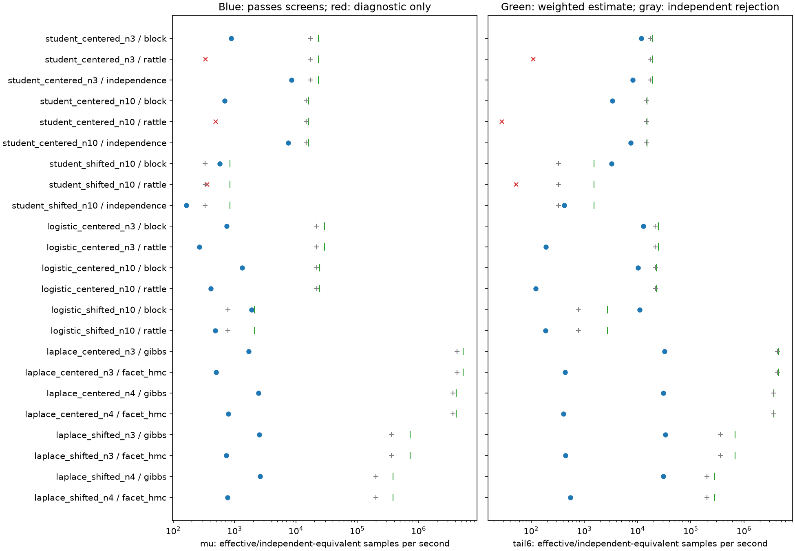
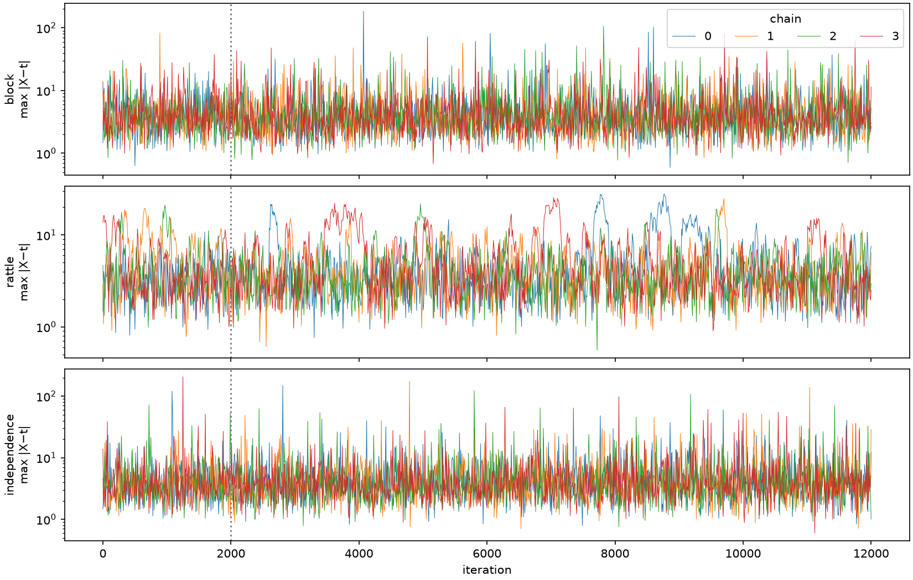
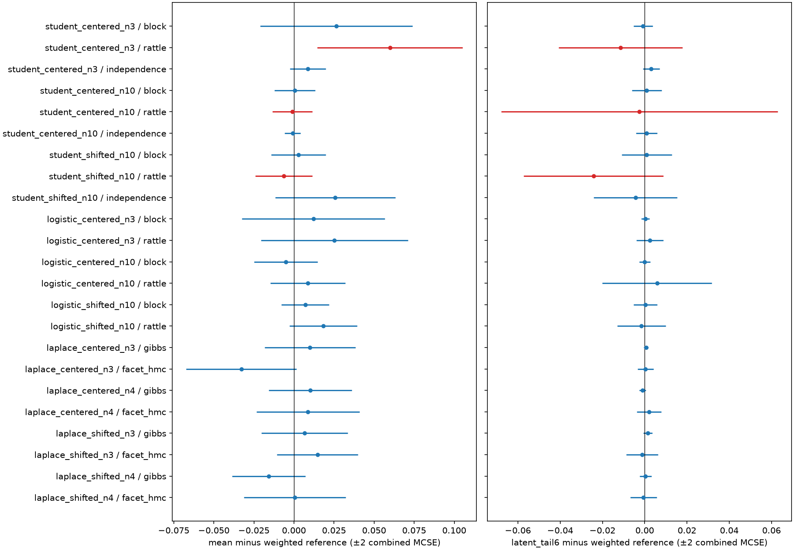

# Location-only performance comparison

12 October 2026. Known unit scale. Student k=2, Logistic and Laplace.

**Result:** direct simulation is the preferred starting point for the centered
cases and for Laplace. Block Gibbs is useful for shifted Student and Logistic
latent-tail estimates. Pure Student RATTLE remains limited by mixing.

All 92 chains completed: 1,104,000 iterations, with no numerical failures.
Twenty of 23 method/case settings pass the declared reference and mixing checks.
All 14 Logistic/Laplace settings pass. The three failures are Student RATTLE.
No sampler, selector, KDE routine or existing evidence was changed.

## Question and controlled method

Which existing selected-statistic method delivers useful parameter and latent
estimates per second? Iteration speed alone cannot answer this question.
The target definitions and kernel derivations remain those in the
[meeting brief](location_only_meeting_brief.md).

The [frozen configuration](evidence/location_only_performance_2026-10-12/config.json)
uses ten established cases. Centered cases have release 0 and prior
\(N(0,2^2)\). Shifted cases have release 1.25 and prior \(N(-0.75,0.6^2)\).
Student and Logistic use n=3 centered, n=10 centered and n=10 shifted.
Laplace uses n=3 and n=4 under both priors. Its even-n statistic is the midpoint
median, not an interval containing the release.

Each method has four chains of 12,000 iterations, discarding the first 2,000.
Starts match weighted-reference maximum-residual quantiles .05, .35, .65 and .95.
Each start includes its corresponding parameter value. Method order rotates
across chains. Seeds, initial datasets and source hashes are saved.

Settings are fixed before execution: parameter proposal SD .45; score proposal
SD .1; block length 4 at n=3 and 16 otherwise. Student RATTLE uses step .1;
Logistic RATTLE and Laplace reflective HMC use step .05. All use ten trajectory
steps. There is no adaptation, latent Gibbs/RATTLE hybrid, tuning grid or run
extension. Affine and transparent pair Gibbs retain their historical evidence;
their old timings are not compared with fresh measurements.

Timing uses one pinned CPU, Intel Xeon Gold 6248R, with one numerical thread.
The environment is Python 3.13.5, NumPy 2.5.2, SciPy 1.18.0 and Numba 0.67.0.
Each case/method receives a 64-iteration warmup. Measured sampling time includes
initial validation, allocation, burn-in and all retained updates. It excludes
compilation, file output, diagnostics and independent oracle checks.
Measured chain time totals 108.77 seconds. The whole study took 174.10 seconds
after imports, including reference construction and analysis.

The initial benchmark-helper preflight had three passes and one failure:
first-use selector compilation exhausted a 10-second bank-test ceiling. Explicit
selector warmup now occurs outside bank timing, with its time and extra call
recorded separately. The final four helper tests pass. No main experiment was
run before this correction.

## References, uncertainty and pass rules

Student references reuse verified raw banks. Bank and selector hashes are
checked, all summaries are recomputed, and existing bootstrap uncertainty is
carried forward. Fresh Logistic/Laplace references use 65,536 independent
standardized datasets per family/sample size. Logistic roots use independent
Brent solves; Laplace uses array medians. Each shifted/centered pair reweights
the same base bank. Uncertainty uses 64 whole-particle bootstrap replicates.

New centered-bank importance ESS is 63,918–65,359. Shifted ESS is 8,444 for
Logistic and 8,732/7,742 for Laplace n=3/4. This improves substantially on the
earlier 4096-row smoke references. Student shifted ESS remains 14,747.

The fixed checks require:

- Rank/split R-hat at most 1.01 and bulk/tail ESS at least 400 for the parameter,
  maximum absolute residual, and residual-above-6 indicator.
- Mean, SD, parameter q05/q50/q95, residual q50/q90/q95, and residual-above-6
  probability within four combined reference/chain Monte Carlo standard errors.
- At least 20 retained tail events overall and at least one in every chain.

Chain uncertainty is the larger of the 500-iteration batch estimate and the
between-chain estimate. Split summaries and residence lengths are retained.
These screens are finite-run diagnostics, not convergence proofs. Extremely
rare parameter events are excluded. Unresolved event uncertainty cannot pass.

Forty-six independent retained-state checks pass, including 18 Student rational
oracle checks. The largest released-statistic error is \(2.80\times10^{-14}\).
No projection/reverse-check failures occurred. This does not certify all possible
inputs or singular configurations.

## MCMC efficiency

The table reports **raw function ESS/sec** for estimating the parameter mean
and \(P(M>6)\), where \(M=\max_i|X_i-t|\). This matches the functions evaluated
by direct Monte Carlo below. Rank-based bulk/tail ESS still controls the mixing
screen. Costs include burn-in. Rates are rounded estimates from this run.
Failed settings retain diagnostic numbers but are excluded from ranking.

| Family/case | Method | µs/iteration | Mean ESS/s | Tail-event ESS/s | Largest R-hat | Screens |
|---|---|---:|---:|---:|---:|---|
| Student n3 centered | Block | 43.0 | 879 | 11,721 | 1.004 | Pass |
| Student n3 centered | RATTLE | 128.9 | 336 | 111 | 1.013 | **Fail** |
| Student n3 centered | Independence | 91.7 | 8,473 | 8,124 | 1.000 | Pass |
| Student n10 centered | Block | 140.4 | 694 | 3,386 | 1.001 | Pass |
| Student n10 centered | RATTLE | 219.4 | 490 | 28 | 1.022 | **Fail** |
| Student n10 centered | Independence | 109.6 | 7,497 | 7,419 | 1.000 | Pass |
| Student n10 shifted | Block | 137.8 | 577 | 3,275 | 1.001 | Pass |
| Student n10 shifted | RATTLE | 214.7 | 355 | 52 | 1.006 | **Fail** |
| Student n10 shifted | Independence | 109.9 | 165 | 419 | 1.006 | Pass |
| Logistic n3 centered | Block | 43.6 | 742 | 12,943 | 1.003 | Pass |
| Logistic n3 centered | RATTLE | 131.4 | 267 | 190 | 1.003 | Pass |
| Logistic n10 centered | Block | 58.0 | 1,338 | 10,267 | 1.002 | Pass |
| Logistic n10 centered | RATTLE | 181.2 | 409 | 122 | 1.007 | Pass |
| Logistic n10 shifted | Block | 56.4 | 1,894 | 10,886 | 1.001 | Pass |
| Logistic n10 shifted | RATTLE | 186.2 | 487 | 188 | 1.002 | Pass |
| Laplace n3 centered | Gibbs | 25.9 | 1,701 | 32,199 | 1.001 | Pass |
| Laplace n3 centered | Facet HMC | 75.8 | 502 | 434 | 1.004 | Pass |
| Laplace n4 centered | Gibbs | 27.0 | 2,441 | 30,754 | 1.001 | Pass |
| Laplace n4 centered | Facet HMC | 78.5 | 787 | 405 | 1.003 | Pass |
| Laplace n3 shifted | Gibbs | 25.2 | 2,535 | 33,104 | 1.002 | Pass |
| Laplace n3 shifted | Facet HMC | 75.7 | 736 | 446 | 1.005 | Pass |
| Laplace n4 shifted | Gibbs | 27.3 | 2,630 | 30,528 | 1.001 | Pass |
| Laplace n4 shifted | Facet HMC | 78.7 | 766 | 548 | 1.003 | Pass |

Full posterior SDs, quantiles, residual quantiles, uncertainties, per-chain/split
summaries and counters are in
[comparisons.json](evidence/location_only_performance_2026-10-12/comparisons.json)
and [comparison_table.csv](evidence/location_only_performance_2026-10-12/comparison_table.csv).

### What the failures show

Student n3 RATTLE misses the lower parameter quantile by 4.60 combined standard
errors and has tail-event R-hat 1.0128. Centered n10 has maximum-residual bulk/tail
ESS 333/186 and tail-event R-hat 1.0219. Shifted n10 has maximum-residual tail ESS
239, below 400, despite acceptable R-hat. Agreement of means would hide these
failures.

The longest retained tail episodes for centered/shifted Student n10 are 630/404
iterations under RATTLE, versus 10/16 under block Gibbs. Shifted independence MH
has a longest tail episode of 205 iterations. It passes, but block Gibbs gives
about 3.5 times its parameter-mean efficiency and 7.8 times its tail efficiency.

Student RATTLE accepts 83.8–85.8% of proposals. It has no projection/reversal
failures, and only 22 global-selection rejections in the shifted case. Thus
projection or selector failure does not explain the observed slow exploration.
The traces support a transport limitation at these fixed settings. They do not
prove topological disconnection.

N3 Student block Gibbs and RATTLE use just four full-selector calls each, one per
chain, because the guarded certificate resolves subsequent checks. That removes
selector cost but does not cure RATTLE's mixing. No high-precision selector
fallbacks occurred in the recorded Student chains.

Logistic RATTLE and Laplace facet HMC pass the longer checks. Their high
acceptances, 96.3–97.6% and 99.1–99.3%, still give poor relative efficiency.
Block/median Gibbs is roughly 3–4 times better for means and 56–84 times better
for tail events in these families. No universal optimal-step-size claim follows.

## Direct weighting and independent rejection

Each control uses a separate fresh bank of 16,384 datasets, independent of the
reference banks. Each method/prior is charged the **full** bank-generation and
MLE cost, even when its base draws are physically shared. Laplace uses the
existing vectorized median construction. Student uses the hardened selector;
Logistic uses scalar Brent roots. Diagnostics are excluded symmetrically.

Weighted observations are not independent posterior draws. The reported
independent-equivalent rate for a function \(g\) uses
\[
N_{\mathrm{eq},g}=
\frac{\sum_i a_i(g_i-\bar g)^2}
     {\sum_i a_i^2(g_i-\bar g)^2},\qquad a_i=w_i/\sum_jw_j.
\]
This compares self-normalized importance-estimator variance with IID posterior
variance. It differs from weight ESS and can exceed the number of proposals.
Rejection rates count actual independent accepted posterior draws.

| Case | Weighted mean equiv./s | Weighted tail equiv./s | Independent rejection/s | Rejection acceptance |
|---|---:|---:|---:|---:|
| Student n3 centered | 23,149 | 19,103 | 17,479 | 91.35% |
| Student n10 centered | 16,047 | 15,172 | 14,820 | 97.67% |
| Student n10 shifted | 846 | 1,534 | 330 | 2.17% |
| Logistic n3 centered | 29,234 | 24,577 | 21,641 | 88.69% |
| Logistic n10 centered | 24,244 | 22,624 | 21,789 | 96.28% |
| Logistic n10 shifted | 2,097 | 2,711 | 777 | 3.43% |
| Laplace n3 centered | 5,344,790 | 4,483,164 | 4,229,944 | 93.25% |
| Laplace n4 centered | 4,079,520 | 3,670,252 | 3,607,189 | 95.11% |
| Laplace n3 shifted | 734,145 | 680,425 | 358,827 | 7.12% |
| Laplace n4 shifted | 385,372 | 281,291 | 201,793 | 4.97% |

These are implementation-specific point estimates. Vectorized Laplace batches
take only 3–5 milliseconds. Their precise rates need longer timing batches
before a publication claim. The large advantage over constrained MCMC is
nevertheless clear at this scale. Scalar Logistic root finding is not an
optimized batching benchmark.

All ten weighted controls agree with their references within four combined
standard errors for the declared summaries; the largest discrepancy is 2.86.
Rejection controls retain honest binomial intervals. Shifted Laplace n3 has only
7 tail events among 1167 accepted draws, with a 95% interval [0.0024, 0.0123].
Shifted n4 has 15/814, with interval [0.0103, 0.0302]. These small controls do not
precisely validate rare-event probabilities by themselves. Their speed does not
remove finite-sample uncertainty.

Variance estimates, rejection intervals, raw-bank costs and provenance are in
[direct_comparisons.json](evidence/location_only_performance_2026-10-12/direct_comparisons.json)
and [direct_table.csv](evidence/location_only_performance_2026-10-12/direct_table.csv).

## Recommendation

1. **Centered Student and Logistic:** prefer raw weighting for summaries or
   rejection for unweighted joint draws. Student independence MH also works well
   when an MCMC interface is useful.
2. **Shifted Student and Logistic:** retain block Gibbs for latent-tail work.
   Its tail efficiency is about 2.1 and 4.0 times the weighted controls.
   Weighted Monte Carlo remains competitive for parameter means; the small
   Logistic mean-rate difference is not a decisive ranking.
3. **Laplace:** prefer direct simulation in these location-only cases.
   Median Gibbs is the better tested MCMC choice when a conditional-chain
   interface is needed. Reflective HMC has no observed practical advantage.
4. **Pure Student RATTLE:** keep its mathematically corrected target, but do not
   recommend these runs as efficient joint posterior simulations. More cheap
   MLE checks alone will not address the measured bottleneck.

The next useful implementation decision is a small common entrypoint for the
existing direct weighted/rejection constructions, with validated statistic
selection and provenance. Further RATTLE work should address transport before
micro-optimizing selection. Neither change is started here.

## Reproduction and preservation

The driver is
[compare_location_only_performance.py](../../scripts/compare_location_only_performance.py).
To repeat sampling, copy the frozen configuration and set **new** raw/evidence
directories. Keep all scientific settings and seeds unchanged. The evidence
directory must exist; the raw directory must not. The driver refuses an already
started study.

    export PYTHONPATH=/tmp/student-mle-oracle-deps-20261003
    export NUMBA_CACHE_DIR=/tmp/student-location-correctness-numba
    export OPENBLAS_NUM_THREADS=1 OMP_NUM_THREADS=1
    .venv/bin/python scripts/compare_location_only_performance.py --config PATH_TO_NEW_CONFIG

The auxiliary oracle path is host-specific; another environment needs the
recorded SymPy/mpmath dependencies. The --analyze option regenerates figures
without resampling. Raw chains and banks remain in
tmp/location_only_performance_20261012/, linked by hashes. The
[evidence directory](evidence/location_only_performance_2026-10-12/) contains
configuration, source/environment records, initial/final preflight output,
execution log, independent checks, tables and figures.

The [preservation audit](evidence/location_only_performance_2026-10-12/preservation.json)
checks all 1474 protected pre-existing source/evidence files, HEAD and the Git
index. No production changes, commits, pushes or extra experiments were made.
