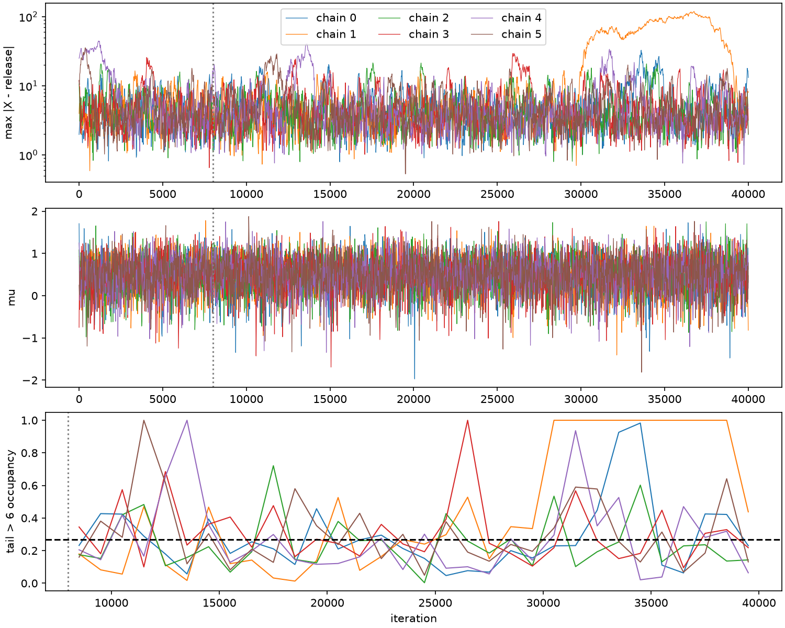

# Shifted Student selected-MLE reference follow-up

Date: 2026-10-10. Domain: unit-scale Student location, **k=2, n=10**, release
**t=1.25**, prior **N(-0.75, 0.6²)**. This follows the
[target audit](selected_mle_target_audit.md),
[reference validation](selected_mle_reference_validation.md), and
[selector hardening](selected_mle_selector_hardening.md).

**Outcome:** the fresh weighted reference is sufficiently precise for the
declared central summaries and latent-tail-above-6 benchmark. An independent
prior-rejection check supports it. The local affine chain agrees on central
parameter summaries but **fails the latent exploration screens** at the fixed
budget. It should not serve as joint ground truth in this case. The rare
parameter upper-tail comparison remains unresolved for affine/rejection samples.
No production sampler, selector, acceptance rule, or KDE was changed.

## 1. Target and experiment contract

**Derivation carried forward, with actual call paths checked.** For independent
standardized datasets E and the translation-equivariant selected global MLE T,

\[
\mu=t-T(E),\qquad X=t\mathbf1+E-T(E)\mathbf1,\qquad w=\pi(\mu).
\]

Normalized weights give the joint selected-MLE posterior reference. The change
from mu to t has scalar derivative one; no extra curvature factor is required.
Fresh independent E accepted with probability
exp[-(mu+0.75)²/(2·0.6²)] yield independent posterior joint draws, subject to
numerical accuracy of T. This is a computationally independent realization of
the same identity, using the same hardened selector; the separate rational
oracle checks address that shared numerical dependency.

The affine sampler is local MH in contrasts followed by a mu MH step. Its
acceptance derivation remains as stated in the audits; this study concerns its
finite-run exploration, not a newly proposed target or acceptance correction.

The [configuration](evidence/shifted_student_followup_2026-10-10/config.json)
was frozen after a separate 2,048-dataset sizing pilot (excluded from every final
reference). The pilot estimated rejection acceptance at 2.01%, with zero
selector failures. The main study uses:

- Two independent weighted banks, **65,536 datasets each**, with different seeds.
- An independent **65,536-proposal** prior-rejection bank and separate acceptance
  RNG. No datasets or accepts are shared with the weighted banks.
- Six affine chains, **40,000 updates each**, discarding the first 8,000:
  **192,000 retained states** in total. tau_q=0.8 and mu proposal SD=0.45 are
  carried forward unchanged.
- A 300-second ceiling per bank/check pass and 180 seconds per chain; external
  process ceilings also apply. Abort on unresolved estimates; never drop or
  replace failed datasets. No tuning or extensions to rescue failed comparisons.
- 100 particle-bootstrap replications per weighted bank and 200 for the pooled
  bank/rejection sample. Resampling whole independent datasets preserves the
  dependence between mu, latent data, and weight.

Reference precision screens: importance ESS at least 10,000; mean and tail-6
bootstrap SE at most 0.01; q05 SE at most 0.04. Exploration screens: R-hat at most
1.01 and bulk/tail ESS at least 400. A four-combined-MCSE discrepancy screen is
descriptive when chains fail convergence diagnostics; it cannot override them.
Rare-event counts are reported without forcing a normal-approximation screen.

## 2. Fresh reference and independent rejection

**Numerical evidence.** All banks were generated with NumPy standard_t and
[global_mle](../../models/loc/student/mle.py), not a legacy cache. The
[driver](../../scripts/followup_shifted_student_reference.py) reuses the existing
weighting, quantile, summary, distance, and R-hat infrastructure.

| Quantity | Weighted bank A | Weighted bank B | Pooled |
|---|---:|---:|---:|
| Independent datasets | 65,536 | 65,536 | 131,072 |
| Importance ESS | 7,437.45 | 7,311.55 | **14,747.27** |
| Posterior mean | 0.49503 | 0.49126 | **0.49314** |
| Mean bootstrap SE | 0.00757 | 0.00718 | **0.00530** |
| P(max residual > 6) | 0.27299 | 0.26552 | **0.26925** |
| Tail-6 bootstrap SE | 0.00503 | 0.00543 | **0.00389** |

The independent banks agree within their Monte Carlo uncertainty. The pooled
maximum normalized weight is 0.0003503, and the predictive density estimate is
0.0144822. Influence-function SEs agree with the bootstrap: mean 0.00520,
tail-6 0.00384. All four frozen reference precision screens pass.

| Summary | Weighted estimate ± bootstrap SE | Independent rejection estimate ± bootstrap SE | Affine estimate ± diagnostic MCSE |
|---|---:|---:|---:|
| mu mean | 0.49314 ± 0.00530 | 0.48983 ± 0.01213 | 0.49323 ± 0.00522 |
| mu SD | 0.43861 ± 0.00552 | 0.44034 ± 0.00989 | 0.43407 ± 0.00382 |
| mu q05 | -0.26500 ± 0.02950 | -0.29720 ± 0.03958 | -0.26763 ± 0.01247 |
| mu q50 | 0.52972 ± 0.00406 | 0.51739 ± 0.01244 | 0.52769 ± 0.00502 |
| mu q95 | 1.14689 ± 0.00174 | 1.13648 ± 0.02165 | 1.14240 ± 0.00402 |
| P(mu < 0.5) | 0.47192 ± 0.00428 | 0.47823 ± 0.01341 | 0.47409 ± 0.00486 |
| P(max residual > 3) | 0.67802 ± 0.00339 | 0.69247 ± 0.01196 | 0.70024 ± 0.01066 |
| P(max residual > 6) | 0.26925 ± 0.00389 | 0.26123 ± 0.01156 | 0.30952 ± 0.02854 |
| Max-residual median | 3.9542 ± 0.0266 | 3.8413 ± 0.0713 | 4.1706 ± 1.1340 |
| Max-residual q90 | 10.3487 ± 0.1305 | 10.1429 ± 0.3637 | 13.5595 ± 12.7268 |
| Max-residual q95 | 14.6804 ± 0.2770 | 14.4518 ± 0.8000 | 27.3055 ± 13.9174 |

Here max residual means max_i |X_i-t|. These are one-standard-error quantities,
not guaranteed confidence intervals. Affine MCSE is the larger of a 1,000-state
batch estimate and the between-chain summary SE. Its large latent-quantile errors
reflect excursions/nonstationarity; they do not establish agreement. The weighted
q05 is usable at the reported precision, not to three decimal places: its
bootstrap percentile interval is [-0.3292, -0.2217]. Weighted tail-6 has percentile
interval [0.26193, 0.27576]. Full intervals are in
[weighted_reference.json](evidence/shifted_student_followup_2026-10-10/weighted_reference.json).

Rejection accepted **1,447 of 65,536 proposals (2.208%)**. Its parameter summaries
and tail probabilities are within 1.2 combined bootstrap SEs of the weighted
reference; maximum-residual quantile discrepancies are within 1.5.
Parameter KS distance is 0.01581 and Wasserstein distance 0.00857, descriptive
empirical distances without an IID KS p-value. Tail-6 has 378 events and exact
binomial 95% interval **[0.23875, 0.28468]**. It is practical as an additional
independent check: base generation took 5.59 seconds, and full normalization
checking another 4.21 seconds, excluding imports and oracle work. Weighting is
more efficient for these summaries: 131,072 weighted proposals give about
14,747 importance ESS versus 1,447 accepted draws from 65,536 rejection proposals.
Importance ESS is a diagnostic, not the effective sample size for every quantity.

## 3. Selector and reconstruction checks

**Numerical evidence, not universal certification.** Across the 196,608 main
standardized datasets there were **zero unresolved/nonfinite MLE calculations**
and three exact rational fallbacks (all in weighted bank B). Their trigger was
an ambiguous likelihood comparison. Every one was independently oracle-checked;
all selected winners agree. A supplementary deterministic replay of bank B
returned exactly the same saved estimates.

Every reconstructed dataset in all three banks was reselected with the hardened
routine: zero failures and maximum released-MLE residual **4.22e-15**. Every
affine proposal/retained state was checked by the unchanged production updates
and driver; maximum retained residual across the chains was **2.89e-15**.

Independent exact rational root/objective-bound checks comprise 131 planned
reference checks, three fallback checks, six initializers, and 54 retained chain
checks: **194 successful checks, zero oracle failures/timeouts**. Spaced checks
are augmented by highest-weight/extreme datasets. Metrics are kept separate:

| Independent check diagnostic | Maximum |
|---|---:|
| Selected-location disagreement | 4.44e-16 |
| Float log-likelihood gap | 7.11e-15 |
| Reduced-score residual | 6.04e-16 |
| Oracle released-MLE residual, normalized data | 2.22e-16 |

Likelihood differences here are at float rounding scale. Only the checked subset
has independent oracle support; checks using the shared selector for all other
states are not independent certificates. The selector's finite-precision,
extreme-range, size and wall-time limitations from its hardening report remain.

## 4. Dispersed affine chains: central agreement, inadequate latent exploration

The production runner hardcodes a constant latent initializer. This isolated
driver supplies normalized starts and calls **the same latent_affine_mh_step
and _update_mu_mh in the same order**, with no acceptance changes. A regression
matches production arrays exactly for identical starts and RNG seeds.

| Chain | Valid latent initializer | Initial max residual | Retained mu mean | Tail-6 occupancy, first / second half | Longest tail-6 run |
|---|---|---:|---:|---|---:|
| 0 | Reference max q10 | 1.971 | 0.49449 | 0.2629 / 0.2979 | 1,847 |
| 1 | Reference max q50 | 3.966 | 0.50344 | **0.1793 / 0.7085** | **9,287** |
| 2 | Reference max q90 | 10.674 | 0.50671 | 0.2513 / 0.2383 | 581 |
| 3 | Negative outlier near -12 | 11.982 | 0.48748 | 0.3144 / 0.3059 | 1,282 |
| 4 | Positive outlier near 25 | 24.991 | 0.49617 | 0.2798 / 0.2667 | 1,734 |
| 5 | Opposing outliers near ±12 | 12.000 | 0.47110 | 0.3332 / 0.2761 | 1,319 |

The initial mu values also differ and are recorded with complete initial datasets
and oracle checks. In particular, the problematic chain started at a modest
maximum residual of 3.97; its later excursion is not simply an extreme initial
dataset persisting throughout burn-in.

| Diagnostic | mu | Maximum residual | Indicator(max residual > 6) |
|---|---:|---:|---:|
| Split R-hat | 1.00096 | **1.07761** | **1.04302** |
| Estimated bulk ESS | 12,232 | **54** | **119** |
| Estimated tail ESS | 17,757 | **14** | **119** |

For continuous quantities, R-hat is the existing rank-normalized split/folded
maximum; binary quantities use raw split R-hat because folding can be constant.
ESS uses split-chain autocovariances with Geyer initial-positive monotone pairs;
bulk ESS uses ranked draws and tail ESS uses 5%/95% quantile indicators. The
research implementation is a diagnostic estimate, not claimed to reproduce every
detail of Stan's estimator. The definitions and convergence cautions follow the
[Stan posterior-analysis reference](https://mc-stan.org/docs/reference-manual/analysis.html).
ESS estimates from chains failing R-hat do not supply calibrated precision.

Posterior central summaries differ from the reference by at most 1.03 combined
diagnostic MCSEs, with parameter KS 0.00551 and Wasserstein 0.00452. However,
the latent maximum has KS 0.04895 and Wasserstein 2.9086, and both latent
exploration screens fail. The pooled tail-6 discrepancy is only 1.40 combined
diagnostic MCSEs **because chain uncertainty is large**; that cannot validate
exploration.

Chain 1 reached maximum residual **120.83**. Its second-half residual median was
44.28, versus 3.45 in its first half; its mu mean also moved from 0.5379 to
0.4690. All chains enter/exit tail-6 states hundreds of times (279–413 entries)
and change the identity of the largest residual thousands of times. These
transitions establish movement, not adequate mixing of distant tail excursions.



**Conclusion from evidence:** the fixed local chain has slow latent-tail
exploration in this experiment. This is a finite-budget failure, not proof of
permanent trapping, nonergodicity, or an incorrect invariant distribution. A
mechanistic explanation in terms of local diffusion in heavy tails is plausible;
its scaling is not established here. No run was extended or proposal retuned.

## 5. Rare-event warnings and what is resolved

The previously disputed parameter event is **mu > 2**, distinct from the moderate
latent event max residual > 6.

- Weighted P(mu > 2) is **1.8881e-5**, bootstrap SE **3.77e-7**, percentile interval
  [1.8161e-5, 1.9569e-5]. There are 5,375 base particles in this region; event
  weight ESS is **3,186.35**. Thus importance
  sampling has actual information about this rare posterior event.
- Independent rejection has **zero events among 1,447 draws**, with exact
  binomial interval **[0, 0.0025461]**. Its zero bootstrap variance is an artifact
  of resampling an event-free sample: final output marks bootstrap uncertainty
  unavailable and uses this positive upper bound instead.
- Affine has **14 event states in only three episodes**, of lengths 1, 4 and 9.
  Raw fraction is 7.292e-5; normal MCSE and its discrepancy screen are marked
  unavailable. Near-one binary R-hat and a nominal large trace ESS cannot make
  three episodes a precise rare-event estimate. No binomial interval is applied
  to correlated chain draws. At the weighted probability, 192,000 IID draws
  would expect only 3.63 events; this comparison is illustrative, not an IID
  assumption for the chain.

The original 4,096-particle reference had ESS 463.6, mean 0.5279 ± 0.0296 and
tail-6 0.2582 ± 0.0203. Its movement to the new estimates is consistent with its
reported Monte Carlo error; the old bank was not reused. **Low reference ESS is
now resolved for the declared summaries. Rare-event affine/rejection precision
is not. Latent affine mixing problems are independently visible in splits,
R-hat, ESS and traces. Numerical MLE failure did not occur in the final study.**

## 6. Verification, provenance, and reproduction

The final focused suite passed **22 tests in 13.99 seconds**, including production
harness equivalence, valid dispersed starts, independent oracle/reference tests,
correlation-sensitive diagnostics, and zero-event uncertainty handling. The
initial 21-test pass and final test log are preserved. No full-repository test
claim is made.

Two development failures are preserved: an initial syntax error caused pytest
collection and the reference command to stop before generating study data; a
supplementary fallback replay timed out at 120 seconds because it repeatedly
decompressed saved estimates. Caching that array fixed the replay, which then
completed in 5.06 seconds. No generated datasets were discarded/replaced. The
first analysis's misleading zero bootstrap error for event-free rejection draws
was corrected and its outputs preserved; only analysis was rerun, with identical
data, seeds, criteria and simulations.

Generation/checking took approximately 29 seconds across all three banks,
excluding bootstrap, imports and oracle work. Six chains took 12.90–14.13 seconds
each (about 81 seconds total), with latent acceptance 0.443–0.453 and mu acceptance
0.652–0.659. Acceptance rates are throughput diagnostics, not validation.

Compact evidence includes [summary.csv](evidence/shifted_student_followup_2026-10-10/summary.csv),
independent reference/rejection/affine JSON records, exact oracle records,
configuration, seeds, source hashes, software versions, logs and a figure.
Raw banks and full chains remain in ignored **tmp/shifted_student_followup_20261010/**;
the [manifest](evidence/shifted_student_followup_2026-10-10/artifact_manifest.json)
connects them to content hashes and regeneration inputs. The preservation check
in [verification.json](evidence/shifted_student_followup_2026-10-10/verification.json)
covers all 485 pre-existing source/evidence files hashed before this task.
driver_at_generation.py preserves the exact driver used for simulation; subsequent
driver changes concern uncertainty reporting only.

From the repository root, install project requirements including SymPy, or use
the already-existing isolated oracle dependency path as below. To regenerate,
copy the configuration and change both output directories to unused paths; the
driver refuses to reuse an existing bank/chain. For example, the copy below uses
a fixed rerun suffix and will refuse a second simulation into those paths. Run
in order:

```bash
export PYTHONPATH=/tmp/student-mle-oracle-deps-20261003
export OPENBLAS_NUM_THREADS=1
.venv/bin/python - <<'PY'
import json
from pathlib import Path
source = Path('docs/research/evidence/shifted_student_followup_2026-10-10/config.json')
cfg = json.loads(source.read_text())
cfg['raw_directory'] += '_rerun'
cfg['evidence_directory'] += '_rerun'
Path('/tmp/shifted_student_followup_rerun.json').write_text(json.dumps(cfg, indent=2))
PY
CFG=/tmp/shifted_student_followup_rerun.json
timeout 700s .venv/bin/python -u scripts/followup_shifted_student_reference.py --config "$CFG" --phase references
timeout 1150s .venv/bin/python -u scripts/followup_shifted_student_reference.py --config "$CFG" --phase chains
timeout 300s .venv/bin/python -u scripts/followup_shifted_student_reference.py --config "$CFG" --phase analyze
PYTEST_DISABLE_PLUGIN_AUTOLOAD=1 timeout 180s .venv/bin/python -m pytest tests/test_shifted_student_followup.py tests/test_selected_mle_reference_validation.py tests/test_loc_affine.py -q --assert=plain
```

The supplemental fallback replay script in the evidence directory records its
original bank path; its command uses PYTHONPATH=.:/tmp/student-mle-oracle-deps-20261003.
It verifies a saved bank and creates no new simulation data.

## 7. Readiness and next decision

**Ready:** use the fresh raw weighted joint reference as the canonical benchmark
for this shifted case, propagating its metric-specific uncertainty. Independent
rejection draws provide a useful secondary check and valid dispersed datasets.
The selected-MLE reconstruction is supported by independent checks on the
declared subset and numerical invariants on all generated states.

**Not ready:** use this local affine run as exact joint ground truth, or declare
its latent tail and rare parameter tail validated. Central parameter agreement
is encouraging but cannot substitute for joint exploration. Fine q05 precision,
much more extreme latent events, universal selector certification and other
parameter regimes remain outside what this study establishes.

**Recommended next step:** when authorized, validate location-only selected-MLE
sampler corrections against the weighted joint reference and independent
rejection particles, monitoring latent maxima and tail movement alongside mu.
Affine exploration improvements should be assessed separately; the present
evidence does not justify changing its invariant-target acceptance formula.
This task stops here. Gibbs/RATTLE cleanup has not begun.
