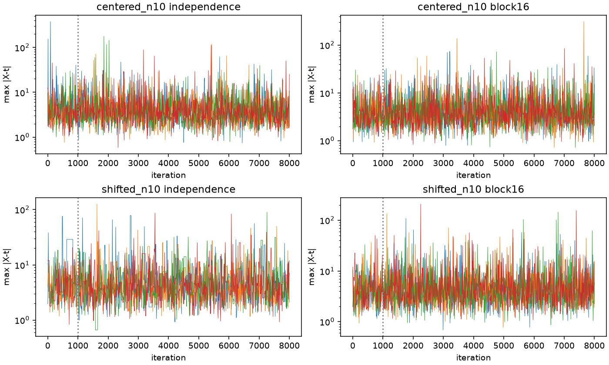

# Independence MH for the selected Student location-MLE posterior

Date: 2026-10-10. Tested cases: unit-scale Student k=2,n=10; centered release/prior (0,N(0,2²)) and shifted (1.25,N(-0.75,0.6²)). **Outcome:** the separate independence-MH sampler has a justified invariant target and passes both bounded reference/mixing screens. It is competitive with block Gibbs in the centered case, but independent rejection is cheaper there. In the shifted case its long holding episodes make unchanged m=16 block Gibbs substantially more efficient.

Existing samplers, hardened selection, KDE, references, and historical experiments were preserved. The [preservation check](evidence/student_independence_geometry_2026-10-10/preservation_check.json) finds **all 873 protected pre-existing files unchanged**.

## 1. Target and measure transformation — proof

Read the selected-MLE [target audit](selected_mle_target_audit.md), [reference validation](selected_mle_reference_validation.md), [selector hardening](selected_mle_selector_hardening.md), [block study](cheap_selected_mle_gibbs.md), [n=3 geometry](student_n3_geometry_selected_mle.md), and [guarded fast-path validation](student_n3_fast_path_validation.md). The direct representation is already established and implemented for weighted/rejection references; this is a separate MH realization, not a new reference identity.

Let q(e)=prod_i f_0(e_i), including fixed known scale. In the generative model, E~q and mu~pi_0 independently, X=E+mu*1. Use the **selected global** statistic T, choosing the smaller location only for genuine exact ties. Its exact translation equivariance gives

\[
U=T(X)=\mu+T(E).
\]

For each fixed e, replacing mu by u is a scalar translation, with derivative one. Fubini therefore gives joint density q(e) pi_0(u-T(e)) in (e,u) coordinates, without differentiating T. At release t,

\[
p_t(e)=\frac{q(e)\pi_0(t-T(e))}{Z(t)},\quad
Z(t)=\int q(e)\pi_0(t-T(e))\,de.
\]

The reconstruction mu=t-T(e), X=e+mu*1 maps this conditional E distribution to the desired **joint** posterior. Its inverse on the selected-statistic fiber is E=X-mu*1. E retains n coordinates: the translation coordinate determines mu; it is not a redundant nuisance coordinate to discard.

No curvature/Gram correction belongs in this E density. The regular physical score-manifold density F_mu J/sqrt(G) and its support indicator emerge when changing the measure again to physical surface coordinates. Appending J to q(e)pi_0(t-T(e)) would change the target. Measurable equivariance suffices; smooth T, unique score roots, and a regular score manifold are not prerequisites. A score root or arbitrary local maximum substituted for T would give a different released statistic and posterior.

## 2. Independent proposal and detailed balance — proof

Propose a fresh E'~q. Write w(e)=pi_0(t-T(e)); then

\[
\alpha(e,e')=\min\{1,w(e')/w(e)\}.
\]

The off-diagonal stationary flux is q(e)q(e')min(w(e),w(e'))/Z, symmetric in e,e'; the stay probability completes detailed balance. There is no separate parameter update: mu changes through reconstruction of the joint proposal. Repeated rejected states **must be retained**; accepted-only points do not generally form independent posterior samples.

For a bounded positive prior, w<=M, the kernel satisfies K(e,de')>=(Z/M)p_t(e')de'. Hence the ideal independence chain is irreducible and uniformly ergodic with minorization Z/M, even if the physical selected-MLE fiber has disconnected regions. With normal weights rescaled to maximum one, this constant equals the independent prior-rejection acceptance rho=E_q[w]. This is a mathematical bound, not a claim that finite-chain ESS meets that best rate.

Stationary independence acceptance has the useful identity

\[
A_{\rm MH}=\frac{E_{q\otimes q}[\min(w,w')]}{E_q[w]}.
\]

It can greatly exceed rho while still producing long correlated holding episodes. The saved reference bank estimates A_MH as 98.481% centered and 20.453% shifted, versus rejection rho estimates 97.745% and 2.178%. These estimates are not exact truths.

## 3. Separate implementation and numerical policy

[loc_student_selected_mle_independence.py](../../models/loc/student/independence.py) adds `run_independence(key, mu_star, params)`, using `initial_e` for a dispersed start. It caches E, T(E), reconstructed mu/X, log prior weight, and a target key. Each new dataset gets **one** hardened global-MLE calculation; a rejection retains the full cached current state. A reused cache with different target parameters raises. There is no score projection, curvature multiplier, proposal tuning, or call to another sampler's acceptance routine.

The code uses local NumPy RNGs, log acceptance and an unfloored MH uniform. It validates finite real data and positive parameters, checks finite reconstruction and residual round trips, and raises on unresolved selection/weights. Iteration failures attach completed partial arrays and their iteration. Numerical failures are never turned into rejections, dropped draws, or automatic replacements.

Known-scale implementation standardizes E before selection and rescales its selected root; the tests include scale 2, but numerical experiments deliberately use scale 1. Full validation over arbitrary scales/dynamic ranges is not claimed.

**Exact-tie reconstruction guard.** Floating addition may perturb tied datasets nonuniformly and change their selected mode. If selection reports a genuine tie, exact binary-rational differences X_i-E_i must prove a common translation; otherwise reconstruction raises without making a second selector call. This conservative guard can also abort a harmless tied translation. A regression covers that behavior and a representable tied reconstruction. Ordinary unique-mode reconstruction uses the existing-style round-trip safeguards, not universal interval certification of T(X).

## 4. Frozen bounded experiment and correctness checks

[Configuration](evidence/student_independence_geometry_2026-10-10/config.json): four existing valid starts per case (low/median/high reference latent maxima and a negative-outlier start), 8,000 iterations, burn-in 1,000, sigma_z=0.1/sigma_mu=0.45 and **fixed m=16** for block Gibbs. That block length was chosen from the existing n=10 study before execution, not tuned here. Independence initialization uses E_0=X_0-mu_0. Seeds are 2026106100+chain_index centered, plus 100 shifted. There are 90-second chain and 240-second chain-batch ceilings; no extensions or additional seeds.

Both paths are freshly timed on the same pinned CPU with one numerical thread; 32-step warmups exclude import/JIT effects and run order alternates across chains. Chain timings use the existing loop convention, including burn-in but excluding setup/initial validation, serialization, diagnostics, and oracle work. No fresh/historical wall-time ratio is claimed. Sixteen recorded chains total 128,000 iterations and completed the chain/analysis phase in 18.98 seconds after imports, with zero numerical failures. A separate fresh 4,096-base-dataset throughput pilot serves both priors; its full generation cost is charged to each alternative.

The canonical reference remains the two validated 65,536-dataset raw banks. Preflight verifies their hashes and hardened-selector source hash, recomputes every summary, and carries forward bootstrap uncertainty. Centered importance ESS is 130,897; shifted ESS is 14,747. The shifted mean 0.493137±0.005301 and tail>6 probability 0.269247±0.003889 are estimates with provenance, not exact targets. No KDE or unchecked cache enters the comparison.

**Final focused tests: 64 passed in 7.94 seconds**, including 14 independence tests, eight geometry tests, and existing selector-hardening regressions. Coverage includes unequal-probability finite-state detailed balance, selected reconstruction, off-center/nonzero-release signs, global exact ties, numerical tie failure, exactly one selector call per proposal, rollback/cache validity, reproducibility/chain independence, invalid inputs, and injected failure with partial results. [Test log](evidence/student_independence_geometry_2026-10-10/pytest_focused.log).

Twelve external chain/proposal oracle checks and four additional direct-pilot checks independently verify selection outside sampler timing/accounting. Retained/independence-proposed X datasets have the released selected MLE within 1e-10; the maximum released residual in the chain audit is 6.89e-15, and maximum selector-versus-oracle location discrepancy is 2.23e-16. Geometry adds six separate oracle cases. Ordinary independence chains made **64,008** selector calls including eight initializations; one successful high-precision fallback occurred centered, zero shifted. Block chains are unchanged and make 54,119 validation calls including initial checks.

The initial independence-only suite passed 13 tests in 128.91 seconds including cold filesystem/import overhead. Subsequent additions bring it to 14. Initial driver preflight failed because its new call swapped weight/data arguments; no chains ran in that attempt. Initial geometry tests had seven passes and one float-division summary failure. Both issues were corrected, final tests and exact geometry rerun, and all initial logs/outputs retained. No test timeout or collection failure occurred.

## 5. Posterior and latent validation

Finite screens fixed before execution: R-hat<=1.01 and bulk/tail ESS>=400 for mu, maximum latent residual M, and its >6 indicator; every resolved summary discrepancy <=4 combined MCSE. MCMC MCSE is the larger of 250-iteration batch and between-chain estimates. Correlated KS/Wasserstein distances are descriptive. The shifted mu>2 event is excluded from normal-uncertainty screens; both chains observed zero events, and its uncertainty is **unresolved**, not zero.

| Case / method | Mean | SD | q05 | q50 | q95 |
|---|---:|---:|---:|---:|---:|
| Centered reference | -0.00122 | 0.42048 | -0.68545 | -0.00029 | 0.68395 |
| Centered independence | 0.00019 | 0.42166 | -0.68399 | 0.00114 | 0.69561 |
| Centered block16 | -0.00111 | 0.42257 | -0.67783 | -0.00883 | 0.70573 |
| Shifted reference | 0.49314 | 0.43861 | -0.26500 | 0.52972 | 1.14689 |
| Shifted independence | 0.49546 | 0.44658 | -0.26107 | 0.51955 | 1.15605 |
| Shifted block16 | 0.49898 | 0.44247 | -0.27692 | 0.53162 | 1.16663 |

| Case / method | M q50 | M q90 | M q95 | P(M>6) ± MCSE |
|---|---:|---:|---:|---:|
| Centered reference | 3.600 | 9.673 | 13.800 | 0.23440 ±0.00109 |
| Centered independence | 3.638 | 9.740 | 13.911 | 0.23607 ±0.00240 |
| Centered block16 | 3.614 | 9.663 | 13.956 | 0.23475 ±0.00327 |
| Shifted reference | 3.954 | 10.349 | 14.680 | 0.26925 ±0.00389 |
| Shifted independence | 3.923 | 10.687 | 15.502 | 0.27286 ±0.01344 |
| Shifted block16 | 3.927 | 10.698 | 15.436 | 0.27111 ±0.00366 |

**All four method/case settings pass the frozen screens.** Largest summary discrepancies are 2.71 combined MCSE centered independence, 1.86 centered block, 0.90 shifted independence and 1.88 shifted block. Shifted independence's parameter mean MCSE is 0.02591 versus block 0.01717; its latent-tail uncertainty is considerably larger. Passing with larger MCSE does not establish equal precision. The minimum independence bulk/tail ESS is 26,829 centered and **523 shifted**; shifted mu R-hat is 1.00766, so that parameter-tail screen passes with limited margin.

Full per-chain/split summaries, all quantiles and distances are in [comparisons.json](evidence/student_independence_geometry_2026-10-10/comparisons.json). The parameter KS discrepancies are 0.00407 centered independence and 0.01343 shifted independence. These are not independent-sample significance tests.

## 6. Mixing, cost, and direct-simulation comparison

| Case / method | us/iteration | Acceptance | Largest R-hat | Mu bulk ESS/sec | M bulk ESS/sec | Tail>6 ESS/sec |
|---|---:|---:|---:|---:|---:|---:|
| Centered independence | 106.0 | 98.54% | 1.00008 | 8,189 | 7,942 | 7,934 |
| Centered block16 | 143.6 | 86.18% | 1.00171 | 708 | 3,665 | 3,766 |
| Shifted independence | 106.4 | 20.32% | 1.00766 | 245 | 421 | 369 |
| Shifted block16 | 130.3 | 82.85% | 1.00253 | 661 | 2,854 | 3,472 |

Each independence step is cheaper than the tested block, but function-specific mixing determines overall efficiency. Centered independence improves parameter bulk ESS/sec about 11.6-fold and latent-tail ESS/sec about 2.1-fold relative to block16. In the shifted case, block16 is about 2.7-fold better for parameter bulk ESS/sec and **9.4-fold better for the latent-tail indicator**. These are fresh same-environment measurements of different kernels, not universal speedups.

| Case / method | Longest M>6 episode | Longest M>20 episode | Longest unchanged latent state |
|---|---:|---:|---:|
| Centered independence | 8 | 3 | 3 |
| Centered block16 | 9 | 5 | 6 |
| Shifted independence | 172 | 76 | 200 |
| Shifted block16 | 11 | 8 | 11 |

These are maxima across four retained chains; thresholds and holding definitions were fixed in advance. M>20 has nonzero observations in every chain, but its probability was not a separate precision acceptance screen. A tail episode can include multiple accepted datasets. The shifted independence chain's slow exploration is therefore genuine holding-time behavior, even though central posterior means agree.



**Mechanism, proof plus observed diagnostics.** At fixed current prior weight w, leaving probability is E_q[min(1,w'/w)], decreasing with w. Shifted retained states with rescaled weight >=0.5 had only 3.06% outgoing acceptance (2,847 observations), compared with 61.46% for weight<0.01 (2,273 observations). Thus prior/proposal mismatch explains the long high-weight holds; this is not a continuous-manifold connectivity trap. These are correlated observational counts, not independent confidence intervals. Evidence: `weight_residence_diagnostics.json`.

**Direct alternatives, one fresh throughput pilot.** The existing raw weighted/prior-rejection construction costs about 66.92 us/base dataset. Independent rejection accepted 4,016/4,096 centered and **86/4,096 shifted**; the latter is too small for a new precise joint-posterior validation. It is a throughput pilot, not a replacement reference.

| Case | Expected independent rejection draws/sec | Weighted importance ESS/sec | Weighted mean equivalent/sec | Weighted tail>6 equivalent/sec |
|---|---:|---:|---:|---:|
| Centered | 14,607 | 14,924 | 15,796 | 14,949 |
| Shifted | 326 | 1,681 | 810 | 1,519 |

Expected rejection counts and weighted efficiency fractions use the **full validated reference**, multiplied by freshly measured pilot cost. Weighted functional equivalents use SNIS variance formulas, not Markov-chain rank ESS; they are plug-in estimates and not strictly interchangeable with bulk ESS. Fresh pilot weight ESS is 4,090 centered and 431 shifted. Resampling weighted particles would not create fresh independent information.

Centered direct rejection is the simplest and cheapest tested independent-joint-draw construction. Shifted independence MH increases acceptance about ninefold over rejection, but does not turn those accepted moves into independent draws. Its tested efficiency is only comparable to rejection and worse than weighted MC for the tail expectation; block16 remains best among these tested correlated samplers for the shifted latent tail. Weighted MC stays the canonical reference and is attractive for posterior expectations.

## 7. Conclusions, limitations, and one next task

**SAMPLING:** independence MH is a useful simple, globally moving baseline and a competitive alternative to block Gibbs for the centered case. Both tested regimes pass bounded correctness/reference screens. It is **not** the preferred shifted-case latent sampler at these fixed settings; longer chains or its acceptance rate would not erase the measured efficiency deficit.

**GEOMETRY:** see the [higher-n preliminary report](student_higher_n_geometry_preliminary.md). Equivariance survives nonunique global modes and singular constraints, while the n=3 median/global-support shortcut does not generalize. The mathematical independence kernel avoids projection and component barriers; hardened selection and numerical reconstruction remain essential.

**NEXT STEP:** one focused exact-algebra study of the selected-MLE transition within the n=5 family (-a,-a,0,a,a). It directly addresses a support boundary inside a single chamber. Retain independence MH as a cross-check, direct rejection centered, raw weighted references, and block Gibbs shifted. No proposal tuning, broader n=20/50 work, cleanup, or unrelated optimization is initiated here.

Limits: Gaussian priors and the two unit-scale n=10 regimes were numerically studied; no universal floating-point certification, arbitrary-dynamic-range validation, high-n robustness, or resolved shifted mu>2 probability is claimed. Tied shifts may fail conservatively; unresolved selector calculations abort. The reports distinguish exact-arithmetic invariant-target proofs from finite-run numerical evidence.

Reproduction commands (the chain driver refuses to overwrite existing raw arrays):

```bash
PYTHONPATH=/tmp/student-mle-oracle-deps-20261003 .venv/bin/python scripts/validate_student_independence_mh.py --config docs/research/evidence/student_independence_geometry_2026-10-10/config.json
PYTHONPATH=/tmp/student-mle-oracle-deps-20261003 .venv/bin/python scripts/verify_student_independence_evidence.py
PYTHONPATH=/tmp/student-mle-oracle-deps-20261003 PYTEST_DISABLE_PLUGIN_AUTOLOAD=1 OPENBLAS_NUM_THREADS=1 .venv/bin/python -m pytest tests/test_student_independence_mh.py tests/test_student_higher_n_geometry.py tests/test_student_location_mle_hardening.py -q --assert=plain
```

For a fresh replay, copy the configuration to a new evidence/raw destination and change only those directory fields. The isolated dependency directory supplies existing SymPy/mpmath; an environment satisfying repository requirements can supply them normally. Portable JSON contains configurations, seeds, starting states, reference/source hashes, counts, timings, summaries, uncertainties, failure logs and oracle checks. Raw trajectories/direct pilots are under `tmp/student_independence_geometry_20261010/` with SHA256 provenance.
