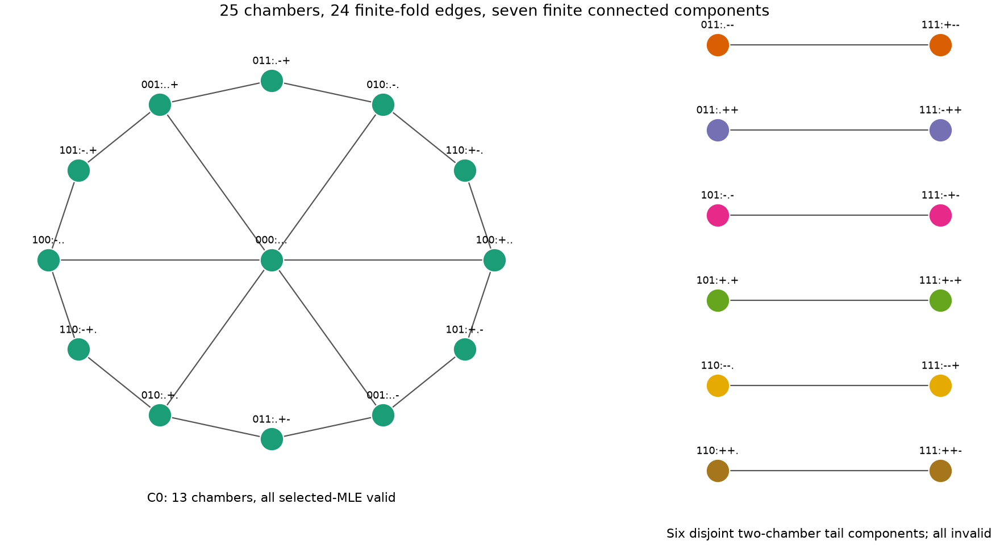
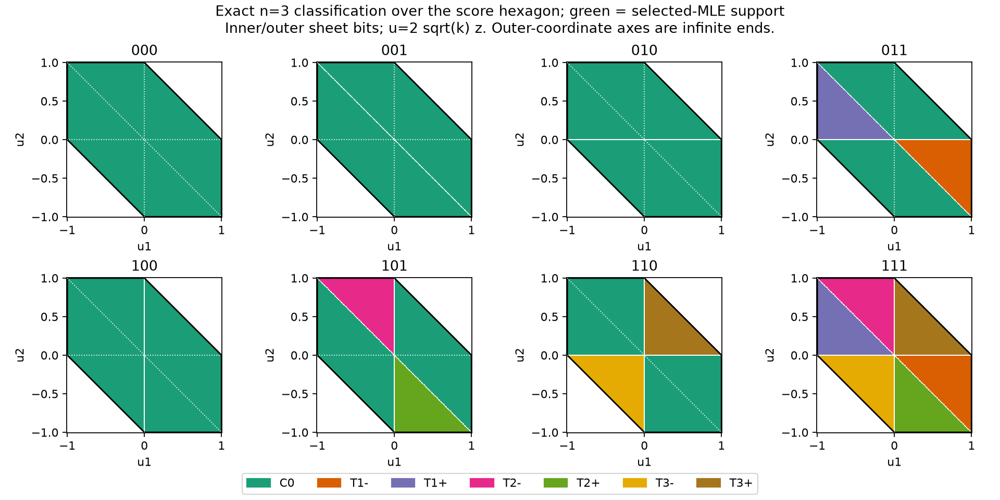

# Student n=3 geometry and selected-global-MLE support

Date: 2026-10-10. Location only, fixed scale and Student degrees of freedom k>0. Primary numerical cases use unit scale, release t=0, and prior N(0,2²).

**Main result, proved below:** the finite score-zero manifold has seven connected components and 25 chambers. Every component is diffeomorphic to a plane. The selected-global-MLE support is **exactly the entire 13-chamber central component**, including its finite folds. The other six two-chamber components are excluded. For three finite observations the global location MLE is unique and nondegenerate; genuine global ties and selected-root curvature degeneracy do not occur. This classification is unchanged by scaling residuals by sqrt(k).

**Important correction to the old interpretation:** a continuous constrained path cannot cross score-manifold components, but a finite RATTLE projection can. A predetermined one-step example below passes the full reverse-phase check while proposing a tail-component endpoint. Corrected selected-MLE RATTLE rejects it correctly. The old small-step trapping runs remain empirical evidence, not a universal reducibility theorem for discrete RATTLE.

New research code, tests, and evidence were added separately. Production and experimental samplers, the hardened selector, existing notes, figures, and historical results were preserved.

## 1. Recovered evidence and what it establishes

Read and traced the [component note](../student_n3_score_manifold_components.md), [discussion source](../student_n3_gibbs_rattle_discussion.tex), [target audit](selected_mle_target_audit.md), [corrected pair-Gibbs validation](student_selected_mle_gibbs_validation.md), [RATTLE validation](student_selected_mle_rattle_validation.md), [block-Gibbs study](cheap_selected_mle_gibbs.md), and selector-hardening report. Additional relevant sources are:

- [verify_student_n3_components.py](../../reporting/diagnostics/verify_student_n3_components.py): signed chambers and exact combinatorial adjacency. Its historical likelihood grid uses floating root calculations and tolerances, not an exact-algebra certificate.
- [study_student_n3_branch_components.py](../../reporting/diagnostics/study_student_n3_branch_components.py) and [study_student_mle_transitions.py](../../reporting/diagnostics/study_student_mle_transitions.py): branch switches, competing modes, and restart studies. The latter's historical global indicator allows a likelihood tolerance, unlike the hardened exact-tie convention.
- [2026-09-20 component checkpoint](../checkpoints/2026-09-20/evidence/n3_components.json): 25 chambers, 24 edges, sizes 13,2,2,2,2,2,2; 8,665 grid comparisons with zero discrepancies. The graph is combinatorial evidence; the grid alone was not a proof of global selection.
- `results/student_n3_branch_components_clean/`, the checkpoint restart/transition copies, and `results/student_n3_discussion_note/figures/`: retained historical plots and tables. The discussion's k=1 refined values (75.375% non-MLE Gibbs occupancy, 2,971 exits) come from `results/student_mle_transition_grid_k1_refined/summary.csv`; the portable `n3_main_numbers.csv` contains only k=2 and k=3. These are separate runs, not interchangeable with the older five-seed branch study.

The old component note asserted a Sturm-sign argument without supplying it. Its classification is correct, but that missing calculation was not a proof. Sections 3–4 supply an exact discriminant/connectedness argument instead. The old assertion that every successful RATTLE update is a continuous path on the manifold is false for the actual finite projection implementation; section 6 gives a numerical counterexample.

## 2. Exact score topology and chamber graph

Normalize r_i=(x_i-t)/sqrt(k) and a_i=r_i/(1+r_i²). Then C=0 is sum a_i=0, with a_i in [-1/2,1/2]. Equivalently u_i=2a_i=2 sqrt(k) z_i lies in the hexagon sum u_i=0 inside [-1,1]^3.

For nonzero |a|<1/2, the two finite inverses are

\[
r_{\rm in}(a)=\frac{2a}{1+\sqrt{1-4a^2}},\qquad
r_{\rm out}(a)=\frac{1+\sqrt{1-4a^2}}{2a}.
\]

They have |r_in|<1 and |r_out|>1. At |a|=1/2 they merge at r=sign(a). At a=0 the only finite inverse is zero; an outer inverse diverges like 1/a. Inner coordinates may cross zero freely. An outer coordinate's sign cannot cross zero through this inverse chart at finite r.

A chamber label is (b,s): b_i=0/1 for inner/outer; s_i=±1 for outer coordinates and zero otherwise. Its score domain is the relative hexagon interior with s_i a_i>0 for each outer coordinate. These domains are nonempty convex regions. Counting gives 1 all-inner +6 one-outer +12 two-outer +6 all-outer =25. The two all-outer equal-sign assignments are infeasible.

**Finite adjacency, proof.** At the fold a_i=s/2, the other two scores sum to -s/2 and both have sign -s on the edge interior. Thus toggling coordinate i to/from outer sign s is allowed exactly when every already-outer other coordinate has sign -s. At hexagon vertices two coordinates fold and the third is inner at zero; the same single-fold graph connects all finite incident chambers. No additional connection arises at an outer-coordinate zero axis because its inverse has no finite limit.

A finite continuous path has compact image, hence bounded coordinates; it cannot use an outer inverse at infinity. Inner zero crossings are already represented within chambers, and all possible finite fold contacts are represented by this graph. The score level is a smooth embedded two-manifold: its gradient could vanish only if all three |r_i|=1, but three scores each ±1/2 cannot sum to zero. Local path connectedness and the finite contacts therefore make the graph's components the manifold's connected components.

There are 24 undirected fold edges. The central component C0 consists of all-inner, six signed one-outer, and six opposite-sign two-outer chambers. For each coordinate r and sign s, T(r,s) consists of the two other coordinates outer with sign s, joined to the all-outer chamber whose coordinate r has sign -s. These give six disjoint two-chamber tail components.



The node names show branch bits followed by outer signs, with dots for inner coordinates. This is a connectivity graph, not a homotopy model: its cycles do not imply holes in the manifold. Outer-zero axes are common score-coordinate limits of distinct inverse sheets, not extra finite edges or an instruction to identify points at infinity.

## 3. Exact likelihood polynomial and central-component positivity

Let D(s)=prod_i [1+(r_i-s)²], and let e_j be the elementary symmetric functions of r. Student location maximization is D minimization: the exponent (k+1)/2 is positive and does not change its minimizer after scaling. Put

\[
N=e_1(1+e_2)+e_3(e_2-3).
\]

The **unconditional polynomial identity**, verified symbolically, is

\[
D(s)-D(0)=-2Ns+s^2Q(s),\qquad C_{\rm norm}(r)=N/D(0),
\]

\[
\begin{aligned}
Q(s)={}&s^4-2e_1s^3+(3+e_1^2+2e_2)s^2\\
&-2\{e_1(2+e_2)+e_3\}s+3+2e_1^2+e_2^2+2e_1e_3.
\end{aligned}
\]

Only on **exact** score zero is N=0 and the requested s²Q factorization valid. For rounded data with score residual epsilon, omitting the linear term changes D(s)-D(0) by exactly 2D(0)epsilon s. This may dominate the quartic term near zero; small floating residuals alone do not justify exact factorization or global comparisons.

**Central sign lemma.** On C0, e2<=0, with equality only at the origin. If a nonzero score triple has two positive observations a<=b and one negative -c, central membership ensures a<=1. The score equation gives psi(c)=psi(a)+psi(b)>psi(a). If c<=1, monotonicity on the inner branch gives c>a; if c>1, again c>a. Hence e2=ab-c(a+b)<-a². Reflecting handles two negative observations; a zero observation forces the other two to have opposite signs, giving e2<=0 directly. The argument includes finite folds.

On any score-zero state e2=3 is impossible: the score identity would give e1=0, whereas e2=(e1²-sum r_i²)/2<=0. Therefore eliminate e3=-e1(1+e2)/(e2-3). Write u=e1, v=e2. Exact symbolic calculation gives

\[
\operatorname{disc}_s Q=
\frac{16[4u^2+(v-3)^2][2u^2(3-v)+9v^2+27]H(u,v)}{(v-3)^4},
\]

\[
H=u^4(v-3)^2+u^2(-8v^3+46v^2-108v+110)
 +16v^4-104v^3+193v^2-78v+9.
\]

For v=-a<=0,

\[
H=u^4(a+3)^2+u^2(8a^3+46a^2+108a+110)
 +16a^4+104a^3+193a^2+78a+9>0.
\]

Every other discriminant factor is strictly positive there. Thus Q has no repeated roots anywhere on C0. At the origin Q=s⁴+3s²+3 has no real roots. Because C0 is path connected, the number of real roots cannot change along a finite path: a conjugate pair could become real only through a repeated root, and bounded monic coefficients on the compact path prevent roots escaping to infinity. Consequently **Q(s)>0 for every real s throughout C0**. Positive discriminant alone would not establish this conclusion; connectedness and the origin supply the missing step.

It follows that D(s)>D(0) for every s!=0: zero is the unique global MLE at every central state. Also

\[
J_{\rm norm}=\sum_i\frac{1-r_i^2}{(1+r_i^2)^2}
=\frac{Q(0)}{D(0)},\qquad
Q(0)=3+v^2+\frac{8u^2}{3-v}>0.
\]

Thus the central selected root is nondegenerate at every finite point, including folds. J may tend to zero along unbounded sequences; there is no uniform positive curvature bound.

## 4. Global classification, ties, scaling, and full component topology

**Existence of a central root for arbitrary data.** Sort any three normalized observations with median b. At location b-1, one residual is 1 and another is >=1: their scores sum to >1/2, while the remaining score is >=-1/2. The total score is positive. At b+1 the analogous argument makes it negative. There is a root strictly between b-1 and b+1. Its median residual lies in (-1,1), so it has no two same-sign outer coordinates and belongs to C0. Section 3 makes it the unique global minimum of D.

For a tail state, zero is not this central root. Strict likelihood dominance from the central root therefore makes zero non-global. This proves the classification over the **whole finite manifold**, not only sampled chambers. An equivalent exact test on score-zero data is

\[
\boxed{T(x)=t\quad\Longleftrightarrow\quad
|\operatorname{median}(x)-t|<\sqrt{k}.}
\]

Median residual exactly ±sqrt(k) is impossible on finite score zero, by the same score bound. The unique score root in median(x)±sqrt(k) is the selected global MLE. The wide data-range bracket can contain other roots; this median bracket cannot. No production selector changes were made.

Consequences: there are **no genuine finite global ties** at n=3; smaller-location tie-breaking is vacuous here. Competing local maxima and degenerate stationary roots can exist in tail components, but they are not selected. The selected statistic is smooth on all finite three-point datasets by uniqueness and the implicit-function theorem, since its J>0. This does not extend to n>3 or to joint location-scale estimation.

For an exact example of why local curvature is insufficient, r=(-13/16,27/11,7) has C=0 and J=412/180625>0. Yet D(27/11)/D(0)=947756221/2185562500<1. Zero is a strict local likelihood maximum and is not global. Its reciprocal inverse choices also supply rational witnesses for the other sheets. The exact comparison is saved in [local_max_counterexample.json](evidence/student_n3_geometry_selected_mle_2026-10-10/local_max_counterexample.json).

Physical scaling gives D_k(s)=k³D(s/sqrt(k)) and D_k(s)-D_k(0)=s²k²Q(s/sqrt(k)) on exact score zero. Hence topology and the indicator classification are identical for k=1,2,3 and indeed every k>0. Posterior chamber probabilities are **not** identical: the Student exponent and prior weights still change with k.

**Each component is a plane, proof.** For C0, let A={a:sum a_i=0}, a plane. The smooth map Phi(a)=a-T(a)1 lands in C0. Its inverse is r -> r-mean(r)1; translation equivariance gives T(r-mean(r)1)=-mean(r). Thus Phi is a global diffeomorphism A -> C0.

For tail T(r,s), use c>0 and p in (0,1). Set its distinguished coordinate to -s c, and the other two to the outer inverses of s p psi(c) and s(1-p)psi(c). Both scores are strictly inside the fold bounds. These are smooth coordinates with smooth inverse c=-s r_distinguished and p=|a_first_outer|/psi(c). At c=1 the distinguished coordinate passes through the finite fold, joining the two chambers smoothly. Therefore each tail component is diffeomorphic to (0,infinity)×(0,1), hence R². These are seven planes, with different infinite limit directions rather than finite contacts.

The selected-MLE support is all of C0, with density F_mu J/sqrt(G), not merely its score-conditioned density F_mu/sqrt(G). Conditioning removes six entire components and changes the weights inside the retained component; it does not excise further regions or holes from C0. Finite folds have zero surface probability but belong to the support. With the positive normal prior, every open central chamber has strictly positive posterior mass.



This figure uses the proved branch/sign classification, not a likelihood grid. An outer coordinate's zero axis has no finite point on that sheet; the same axis is allowed for an inner coordinate. The physical branch folds lie on the relevant hexagon edges. Charts fold, but G>0 on every finite point of the score manifold.

## 5. Sampler occupancy and accepted transitions from saved evidence

All saved k=2 corrected pair-Gibbs, block-Gibbs, and RATTLE chains were reclassified by signed chambers. Original array hashes were checked. Each of their four chains visited **all 13 central chambers**, with no retained tail states or accepted component changes. These are finite-run exploration observations, not a proof of convergence or a rate bound.

| Method | Retained | Accepted/attempts | Global-selection rejects | Each chain visits | Chamber transitions | Largest chamber difference (MCSE) |
| --- | --- | --- | --- | --- | --- | --- |
| Corrected pair Gibbs | 40000 | 29317/48000 | 1350 | 13 / C0 only | 11710 | 1.39 |
| Corrected RATTLE | 40000 | 40450/48000 | 0 | 13 / C0 only | 11932 | 2.61 |
| Block m=1 | 20000 | 20433/24000 | 59 | 13 / C0 only | 8292 | 2.58 |
| Block m=4 | 20000 | 19046/24000 | 66 | 13 / C0 only | 10504 | 1.93 |
| Block m=16 | 20000 | 18385/24000 | 57 | 13 / C0 only | 10809 | 1.61 |

Differences use the larger of batch/chain MCMC MCSE and combine it with independent-reference SNIS uncertainty. The saved raw weighted reference has 32,768 particles and weight ESS 32,009. Its 3,748 independent prior-rejection draws also visit the central chambers and differ by at most 2.03 combined chamber MCSE. No KDE enters these estimates. Proposed/accepted totals include burn-in; chamber transitions and mass comparisons exclude it. Transparent Gibbs's global-rejection count occurs after earlier cheap tests; it is not all proposals outside the support. Likewise block and RATTLE global rejection counts exclude endpoints already rejected by curvature or cheap MH.

The retained legacy score-Gibbs display segment (`tmp/gibbs-evolution-mle-chain.csv`, k=1, iterations 506–3000) visits five score components, with 460 component changes and 1,591/2,495 states outside C0. Its recorded global indicators agree with the new classification. It is a different historical run/prior and is not a selected-target posterior comparison. The old refined full-grid evidence separately records 75.375%, 43.3925%, and 8.8075% non-MLE occupancy for k=1,2,3. Old branch-code-only tables cannot recover signed component occupancy without coordinates or outer signs.

The archived restart summary contains 12 central and 36 tail starts, with zero changes in their reported MLE/non-MLE groups and acceptance 0.998625–1. Its initial coordinates agree with the signed classification. The summary retains branch codes and group occupancy, but not complete signed trajectories: it cannot establish constancy of an individual named tail component. See [historical_restart_reconciliation.json](evidence/student_n3_geometry_selected_mle_2026-10-10/historical_restart_reconciliation.json).

**Moves and their geometry.** Legacy score Gibbs can jump across components through conditional inverse-branch refresh, including after a scalar-score MH rejection. Corrected joint-pair Gibbs rejects a whole MLE-invalid candidate, keeping the previous dataset. The block sampler may use MLE-invalid inner states, then accepts or restores the whole block. Parameter updates change mu, not chamber labels relative to fixed t. Independent normalized reference draws have no Markov transition path and are always selected-support states under accurate T.

At a generic fixed score vector with one positive and two negative scores, six of eight branch configurations are central; the two having both negative coordinates outer are the tail pair. The reflected situation is identical. Selecting only these central branches is not by itself the complete conditional law: inverse Jacobians and J remain necessary. Any central state can reach the all-inner sheet via nonlocal pair branch changes, and score moves on that sheet supply access to the other valid chambers. This gives an ideal-kernel accessibility mechanism, not a universal finite-precision ergodicity theorem.

## 6. Continuous paths versus actual finite RATTLE projections

Continuous finite paths on the constraint manifold remain in one of its seven components. A RATTLE step first makes an off-manifold drift and solves a nonlinear projection; the resulting discrete map is not such a path. Local transversality and a successful reverse solve do not require its two positions to share a component.

**One predetermined numerical probe**, k=1, mu=0, x=(0,0,0), tangent momentum p=(-4,-2,6), one step of size 1, using the unchanged guiding Hamiltonian and existing checked projection machinery:

- Endpoint approximately (-7.2356683,-5.2356683,2.7643317), in T(3,-).
- Forward score residual 5.55e-17, projection transversality 0.8361; reverse position/momentum errors 7.05e-15/4.35e-15. The full phase proposal is admissible.
- Independent rational oracle selects location -5.6104012, rather than release zero.
- Score-target Hamiltonian acceptance probability is approximately 2.13e-9: small but positive. No accepted random-chain transition is claimed.
- Corrected selected-MLE RATTLE rejects for negative curvature and retains the original dataset.

This is a numerical counterexample to unconditional component preservation by finite RATTLE. It is not a tuning recommendation, a new chain run, or a global irreducibility result. Its configuration, phase diagnostics, energy values, oracle result, and selected-step replay are saved in [projection_probe.json](evidence/student_n3_geometry_selected_mle_2026-10-10/projection_probe.json), with a focused regression. The historical small-step restarts still show trapping for their declared settings; they do not forbid the probe above. Endpoint nonadjacent chamber labels alone are also insufficient evidence of a component jump: a multistep trajectory can traverse several finite folds.

For the desired n=3 selected target, the six tail components have zero mass, so bridging them is not a sampling requirement. Within-central latent-tail transport remains a practical issue. The existing corrected-RATTLE n=10 mixing failures cannot be explained or resolved by extrapolating this n=3 theorem.

## 7. Small k=1/2/3 stress investigation

The [frozen configuration](evidence/student_n3_geometry_selected_mle_2026-10-10/config.json) adds only k=1 and k=3: one fresh 8,192-particle weighted bank each, four length-4 block chains each, 4,000 blocks with burn-in 1,000 (12,000 retained per k). k=2 evidence above is reused. Fixed sigma_z=0.1, sigma_mu=0.45; diverse valid reference-quantile and negative-outlier starts. No tuning or extensions. Reference seeds 2026104100+k; chain seeds 2026104300+100k+index. Reference/chain ceilings are 60/120 seconds, with an outer 240-second command ceiling.

Both fresh banks and all eight chains completed without selector or sampler failures. Each chain visited all 13 central chambers. Screens retain R-hat<=1.01, bulk/tail ESS>=400 for mu, maximum residual and its >6 indicator, and <=4 combined MCSE for posterior/latent summaries and individual chamber probabilities.

| Estimate | Mean | SD | q05 | q50 | q95 |
| --- | --- | --- | --- | --- | --- |
| k=1 weighted reference | -0.0151 | 0.8987 | -1.4717 | -0.0147 | 1.4244 |
| k=1 block m=4 | -0.0485 | 0.8913 | -1.5072 | -0.0365 | 1.3386 |
| k=3 weighted reference | -0.0063 | 0.7074 | -1.1425 | -0.0163 | 1.1319 |
| k=3 block m=4 | -0.0258 | 0.6814 | -1.1237 | -0.0344 | 1.1029 |

| k | Reference weight ESS | Outer acceptance | Maximum R-hat | Minimum bulk/tail ESS | Largest chamber difference (MCSE) | Global-selection rejects |
| --- | --- | --- | --- | --- | --- | --- |
| 1 | 7637 | 48.49% | 1.00719 | 447 | 1.43 | 607 |
| 3 | 8081 | 85.59% | 1.00705 | 807 | 2.03 | 6 |

All screens pass, but k=1's mu bulk ESS is only 447, and its estimated tail mass/upper latent quantiles remain imprecise. In particular P(M>6)=0.25758 ±0.01788 versus reference 0.23637 ±0.00468; k=3 gives 0.02442 ±0.00138 versus 0.02372 ±0.00172. These are diagnostic one-standard-error uncertainties, not high-precision agreement. Full means, SDs, quantiles, tail probabilities, per-chain mass and diagnostics are in [new_block_comparisons.json](evidence/student_n3_geometry_selected_mle_2026-10-10/new_block_comparisons.json). No rare-tail zero is assigned zero uncertainty.

Reference chamber masses for the stated centered prior:

| Central chamber | k=1 mass (%) | k=2 mass (%) | k=3 mass (%) |
| --- | --- | --- | --- |
| 000:... | 21.474 | 48.356 | 67.204 |
| 001:..+ | 8.444 | 7.140 | 4.745 |
| 001:..- | 8.822 | 7.173 | 4.956 |
| 010:.+. | 8.826 | 7.097 | 4.748 |
| 010:.-. | 8.955 | 7.190 | 4.678 |
| 011:.+- | 4.807 | 1.550 | 0.641 |
| 011:.-+ | 4.848 | 1.576 | 0.601 |
| 100:+.. | 8.130 | 6.949 | 4.924 |
| 100:-.. | 8.101 | 6.791 | 5.042 |
| 101:+.- | 4.714 | 1.573 | 0.447 |
| 101:-.+ | 4.191 | 1.530 | 0.609 |
| 110:+-. | 4.567 | 1.582 | 0.804 |
| 110:-+. | 4.121 | 1.492 | 0.601 |

These are raw weighted estimates; full per-chamber MCSEs are in [chamber_probabilities.json](evidence/student_n3_geometry_selected_mle_2026-10-10/chamber_probabilities.json). In the population, centered-prior reflection and observation exchangeability make the six one-outer masses equal and the six opposite-sign two-outer masses equal. Finite-bank differences among these labels are Monte Carlo noise. The smallest estimated valid chamber mass is about 4.12%, 1.49%, and 0.45% at k=1,2,3; small k=3 chambers are real, positive-probability regions, not absent support. The all-inner/one-outer/two-outer totals are approximately (21.47,51.28,27.25)%, (48.36,42.34,9.30)%, and (67.20,29.09,3.70)%. Scaling geometry does not equate statistical mass.

## 8. Inner-block excursions and numerical boundary limits

A mechanism-only diagnostic holds mu=0 and uses 256 blocks for each k and m=4/16. A separate compiled tracer records inner states, then replays the unchanged production block with the same seed; proposed endpoints match bit for bit. These are not posterior-reference chains. Zero recorded excursions in the k=3, m=4 diagnostic do not establish zero excursion probability. Their fixed-mu excursion frequencies should not be substituted for posterior probabilities.

| k | m | Accepted/256 | Blocks entering tails | Accepted after a tail visit | Invalid endpoints | Global rejects | Negative-J rejects |
| --- | --- | --- | --- | --- | --- | --- | --- |
| 1 | 4 | 149 | 139 | 59 | 64 | 10 | 41 |
| 1 | 16 | 136 | 241 | 125 | 73 | 5 | 49 |
| 2 | 4 | 198 | 15 | 7 | 5 | 1 | 1 |
| 2 | 16 | 212 | 56 | 49 | 2 | 0 | 1 |
| 3 | 4 | 233 | 0 | 0 | 0 | 0 | 0 |
| 3 | 16 | 216 | 7 | 5 | 1 | 0 | 1 |

Accepted examples explicitly enter a tail component and return to C0. Independent oracle checks confirm both the invalid intermediate state and valid accepted endpoint. Thus preventing all inner tail visits would change the proposal and remove observed shortcuts. The reversible block's invariant-target proof requires only the endpoint W correction, not selected validity at every inner step.

**Adversarial checks:** 25 exact rational chamber witnesses are checked at each k, plus 13 declared boundary/adversarial configurations at each k: 114 selector/oracle comparisons. Cases include finite folds, near-fold inverses, outer scores 1e-12 and 1e-20, near-equal competing maxima, selected curvature tending to zero, and a genuinely degenerate unselected stationary root. All global selector/oracle comparisons completed, with maximum selected-location difference 1.39e-16 and likelihood gap 8.89e-16. Binary-float observations are treated as exact rationals by the oracle, separately from their underlying exact algebraic construction.

There are important explicit limits. Among the 39 boundary checks, six endpoint checks raise: three nearly flat central states exceed the current score/curvature location-resolution guard, and three degenerate tail states have unresolved curvature. Four diagnostic pair updates also raise at fold/current-score interval resolution. Exact finite folds are mathematically valid selected states, but the pair implementation uses regular inverse charts and can refuse an exact fold; this is a zero-measure boundary, not permission to remove a neighborhood. Extremely flat selected configurations can cause false conservatism because ordinary double-precision score cancellation dominates the true residual.

Independent 90-digit evaluation of the k=1 flat example at an approximately 8e16 outlier gives true binary-input score -3.19e-25 and J=1.46e-9, whereas the ordinary score sum is 1.25e-17. High-precision root refinement agrees with the rational oracle to about 1.82e-17. The endpoint guard failure is therefore numerical score evaluation/resolution, not wrong global selection. Near-competing maxima have positive high-precision log-likelihood gaps about 9.15e-12 and 9.15e-17; they are not exact ties. These supplementary calculations refine isolated roots and evaluate gaps; they do not replace exhaustive rational root isolation. See [stress_oracle.json](evidence/student_n3_geometry_selected_mle_2026-10-10/stress_oracle.json) and [high_precision_stress.json](evidence/student_n3_geometry_selected_mle_2026-10-10/high_precision_stress.json).

One exact degenerate-tail family is (-c,a,a), where a² is the real root of u³-15u²+7u-1 and c²=2a²/(3a²-1), with positive c,a. Its score and J vanish, but its global MLE is elsewhere in C0. This illustrates why an arbitrary stationary-root degeneracy must not be confused with a selected-MLE degeneracy.

## 9. Verification, preservation, and reproduction

Exact symbolic checks verify the general sextic identity retaining its linear term, constrained quartic discriminant, and positive-coefficient H certificate. QQ Sturm root counts validate the 25 rational chamber witnesses. This supports the supplied general proof; it is not being substituted for one. Focused tests also independently reconstruct fold feasibility, verify scaling, reject approximate exact-factorization inputs, compare tracer/production RNG outputs, and cover the discrete RATTLE counterexample and selected rejection.

The first 120-second test command timed out after 31 checks before the compiled replay checks completed. Its log is preserved. The retry passed **37 tests in 18.67 seconds**; two added focused regressions passed **1 in 3.92 seconds** and **1 in 10.40 seconds**. Thus **39 focused checks passed across the final three commands**, with the initial timeout reported explicitly. No final test or collection failure occurred. There are **178 successful oracle comparisons**: 114 stress, 40 fresh-bank/chain, 3 saved reference, 20 excursion, and 1 projection. Those inspect subsets of saved/new stochastic states; they do not certify every retained state numerically.

An initial supplemental historical-reconciliation process also hit a 60-second command ceiling without producing its table. Its bounded 120-second retry, with single-thread settings, completed; no historical results were changed. All primary mathematical, reference, chain, stress, excursion, and figure phases completed at their declared bounds.

New files: [research geometry helpers](../../reporting/diagnostics/student_n3_selected_geometry.py), [study driver](../../scripts/study_student_n3_selected_geometry.py), and [focused tests](../../tests/test_student_n3_selected_geometry.py). All 441 inventoried pre-existing files retain their hashes. Original raw chains/banks were hash-verified before reanalysis; neither they nor historical figures were changed. New bulky arrays are in ignored `tmp/student_n3_geometry_selected_mle_20261010/`. [Evidence](evidence/student_n3_geometry_selected_mle_2026-10-10/) includes configuration, algebra, graph, tables, logs, source hashes, raw provenance, [preservation check](evidence/student_n3_geometry_selected_mle_2026-10-10/preservation_check.json), and [artifact manifest](evidence/student_n3_geometry_selected_mle_2026-10-10/artifact_manifest.json). The driver snapshot preserves the source used for experiments; the final driver only improves graph layout relative to that snapshot. PNG and PDF figures are reproducible from the proof classification without rerunning MCMC.

From the repository root:

```bash
PYTHONPATH=/tmp/student-mle-oracle-deps-20261003 PYTEST_DISABLE_PLUGIN_AUTOLOAD=1 timeout 240s .venv/bin/python -m pytest tests/test_student_n3_selected_geometry.py tests/test_student_n3_component_graph.py -q --assert=plain
PYTHONPATH=/tmp/student-mle-oracle-deps-20261003 .venv/bin/python scripts/study_student_n3_selected_geometry.py --config docs/research/evidence/student_n3_geometry_selected_mle_2026-10-10/config.json --phase algebra
```

For fresh stochastic reproduction, copy the configuration, set fresh raw/evidence paths, and run `blocks` and `excursions`; the driver refuses to overwrite fresh-bank/chain arrays. `saved`, `stress`, and `figures` reproduce the corresponding analyses. The supplemental oracle dependency path contains SymPy/mpmath in this environment. Reproduction requires the referenced original arrays, not only the figures; manifest paths are local workspace artifacts.

The saved [supplemental_checks.py](evidence/student_n3_geometry_selected_mle_2026-10-10/supplemental_checks.py) reproduces the fixed `precision`, `projection`, and `historical` checks with the same Python/dependency environment. These are replays of the recorded cases, not a parameter search. Each primary phase is subject to its documented command/chain/oracle ceilings; the study stops after this evidence package.

## 10. Next priority

**Recommended next task: a bounded n=3 geometry-based endpoint fast path with careful numerical guards**, rather than a new component-bridging algorithm. Exact score zero plus the median test proves global selection; the unique-root median bracket also permits a simpler independent root check. This can remove ordinary endpoint enumeration while retaining J and the current block proposal. The flat/fold stress failures show why accurate score evaluation, root-location resolution, and fallback to the hardened selector must accompany it. No such fast path was implemented here.

Broader block-Gibbs stress testing at n>=10 should follow that narrowly tested improvement; the median theorem does not apply there. Remaining questions are numerical reliability near infinite/flat limits, finite-run precision at k=1, mixing rates for rare latent events, and behavior beyond three observations. The old n=3 global-MLE classification conjecture is resolved by the proof above. No RATTLE tail optimization, selector modification, or repository cleanup was begun.
