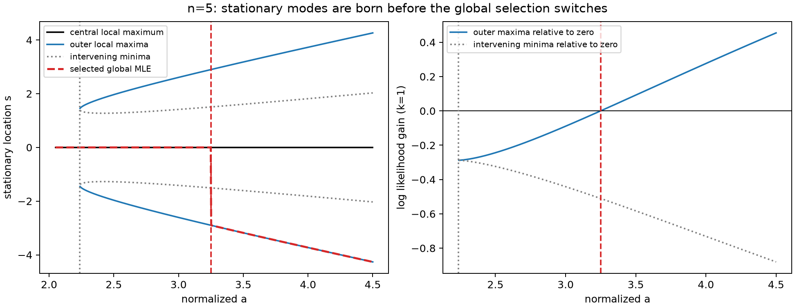

# Exact n=5 selected-global-MLE boundary inside one score chamber

Date: 2026-10-10. This is an exact-algebra investigation of one family and its local selection boundary, not a classification of the whole n=5 manifold. Existing samplers, selectors, reference banks and historical evidence are preserved. No MCMC chains were run.

**Result:** there is exactly one global transition for normalized a>1. Below it zero is the unique global MLE; at it exactly three nondegenerate global maxima coexist; above it only the two outer maxima are global. The smallest-location convention excludes zero at the transition. The transition is inside a regular, unchanged score chamber with strictly positive curvature at zero.

## 1. Normalization and theorem

Write normalized data r=(-a,-a,0,a,a), a>1, normalized candidate location s, and A=a². This means k=1 in the denominator algebra. For Student degrees of freedom k>0 and known scale sigma, the corresponding physical data are t+sigma sqrt(k) r and physical candidate locations are t+sigma sqrt(k) s. Maximizing the Student likelihood is equivalent to minimizing

\[
D_A(s)=\prod_i[1+(r_i-s)^2],
\]

because its exponent -(k+1)/2 is strictly negative. Changing k changes likelihood values and posterior masses, but not this normalized maximizer classification. For literal unit-scale physical data (-b,-b,0,b,b), the critical b is sqrt(k) a_c; it is **not** a k-independent physical threshold.

**Global classification theorem.** Let A_c be the unique positive root of

\[
\boxed{K(A)=256A^5-1973A^4-7292A^3-4310A^2-1100A-125.}
\]

It lies in (10,11). Put a_c=sqrt(A_c) and, for A>5,

\[
v_\pm(A)=\frac{3A-5\pm2\sqrt{A(A-5)}}5,\qquad s_+(A)=\sqrt{v_+(A)}.
\]

For every a>1:

| Parameter | All global likelihood maximizers | Selected statistic T(r) |
|---|---|---|
| 1<a<a_c | {0} | 0 |
| a=a_c | {-s_c,0,s_c}, s_c=s_+(A_c) | -s_c |
| a>a_c | {-s_+(A),s_+(A)} | -s_+(A) |

All three boundary maxima are strict, nondegenerate local maxima. There is no other global transition for a>1. Outer stationary modes first appear at a=sqrt(5), **before** the global transition.

Certified rational-decimal enclosures, each of width 10^-32, are:

\[
\begin{aligned}
10.55928405860348258584238474296553&<A_c<10.55928405860348258584238474296554,\\
3.24950520211977543247952593810617&<a_c<3.24950520211977543247952593810618,\\
8.40026120683247711595509362475153&<v_c<8.40026120683247711595509362475154,\\
2.89832041134731636074353702129577&<s_c<2.89832041134731636074353702129578.
\end{aligned}
\]

These are outward **exact rational endpoints with Sturm root counts**, not rounded standard-error estimates. The [algebra certificate](evidence/student_n5_boundary_2026-10-10/algebra.json) stores all fine real-root isolations and exact identities.

## 2. Complete proof: stationary points and the unique global switch

**Factorization.** Pairing the repeated observations at ±a gives

\[
[1+(a-s)^2][1+(a+s)^2]
=(s^2+1+A)^2-4As^2=P(s^2),
\]

\[
P(v)=v^2+2(1-A)v+(1+A)^2=(v+1-A)^2+4A>0.
\]

Thus D_A(s)=(1+s²)P(s²)². Direct differentiation gives

\[
D_A'(s)=2sP(s^2)R(s^2),\quad
R(v)=P(v)+2(1+v)P'(v)
=5v^2+(10-6A)v+(A-1)^2+4.
\]

The zero score is exact by symmetry. Its curvature is

\[
J(0)=1+4\frac{1-A}{(1+A)^2}
=\frac12+\frac{(A-3)^2}{2(A+1)^2}\ge\frac12.
\]

Also G(0)=1+4[(1-A)/(1+A)²]²>=1, so the score manifold is regular at every family point. Zero is always a strict local likelihood maximum.

**All real stationary points.** The discriminant of R is 16A(A-5). For 1<A<5 there are no real R roots and R>0. At A=5, R=5(v-2)². Therefore D increases strictly on s>0 for 1<A<=5 (its derivative only vanishes at an isolated point when A=5), and zero is uniquely global. The stationary points ±sqrt(2) at A=5 are double roots of D', not additional local maxima.

For A>5 both roots v_-<v_+ are positive: their sum (6A-10)/5 and product [(A-1)²+4]/5 are positive. On s>0, D' is positive, negative, positive on the three intervals separated by sqrt(v_-),sqrt(v_+). Hence the complete real stationary list is

\[
-\sqrt{v_+},\ -\sqrt{v_-},\ 0,\ \sqrt{v_-},\ \sqrt{v_+}.
\]

Only 0 and ±sqrt(v_+) are local likelihood maxima and possible global maxima. In particular D(sqrt(v_-))>D(0). Since D tends to infinity, there are no other global candidates. At the outer minima of D,

\[
D''(\sqrt{v_+})=4v_+P(v_+)R'(v_+)>0.
\]

**Strict monotonicity of the global competition.** Define

\[
g(A)=\log\frac{D_A(\sqrt{v_+(A)})}{D_A(0)},\quad A>5.
\]

The stationary condition removes the v_+' term when differentiating the objective. Consequently

\[
g'(A)=\frac{4v_+(A)[A-3-v_+(A)]}{(1+A)P(v_+(A))}<0.
\]

For the inequality, v_+-(A-3)=2[5-A+sqrt(A(A-5))]/5>0, because sqrt(A(A-5))>A-5 for A>5. At birth g(5+)=log(4/3)>0. At A=25, D_25(5)=265226<D_25(0)=456976, so its outer minimum also has g(25)<0. Continuity and strict decrease prove exactly one zero on **all** A>5. This rules out repeated transitions without a numerical grid. The resulting sign of g proves the classification table. The boundary has exactly the three candidates listed, all nondegenerate.

## 3. Exact elimination and independent algebraic tie oracle

Divide the objective equality by v>0 and define the quartic

\[
\begin{aligned}
H(A,v)={}&v^4+(5-4A)v^3+(6A^2-8A+10)v^2\\
&+(-4A^3+2A^2+10)v+A^4+2A^2+8A+5.
\end{aligned}
\]

Exact elimination gives

\[
\operatorname{Res}_v(R,H)=-(A^2-2A+5)K(A).
\]

The quadratic factor is positive for real A. Thus the unique transition must be a root of K. Its coefficient sign sequence has one change, so Descartes' rule gives exactly one positive root, counting multiplicity; K(10)<0<K(11). This identifies the transition unambiguously and proves simplicity. An independent Sturm calculation finds exactly three real K roots, one in each of (-3,-2),(-1,-1/4),(10,11); the two negative roots cannot represent A=a². Exact factorization over Q also certifies K irreducible.

For the competing location, the other resultant is

\[
\operatorname{Res}_A(R,H)=-v^2 L(v),
\]

\[
\boxed{L(v)=256v^5-1009v^4-7744v^3-14240v^2-10240v-2560.}
\]

L has one positive root and two negative real roots. The v² factor is excluded by v>0. Therefore a_c is the unique positive root of K(a²), and s_c the unique positive root of L(s²). Sturm isolation of these polynomials proves the displayed enclosures directly.

**Independent irreducibility certificate.** The monic reductions of K and L modulo 7 are respectively

\[
z^5+2z^4+4z^3+4z^2+5z+2,\quad
z^5+5z^4+3z^3+3z^2+2z+4.
\]

For each, exact finite-field arithmetic verifies z^(7^5)=z modulo the polynomial and gcd(f,z^7-z)=1. Since the degree five is prime, these are the complete irreducibility conditions. The integer polynomials are primitive and retain degree modulo 7, so Gauss' lemma gives irreducibility over Q. [Five-step Frobenius residues and gcds](evidence/student_n5_boundary_2026-10-10/irreducibility_mod7.json) are independently reproduced by [verify_student_n5_irreducibility.py](../../scripts/verify_student_n5_irreducibility.py).

An exact back-substitution, independent of any floating MLE evaluation, is

\[
v_c=\frac{N(A_c)}{B(A_c)},
\]

\[
\begin{aligned}
N(A)&=64A^4+82A^3-50A^2+950A+250,\\
B(A)&=64A^3+335A^2-550A-125.
\end{aligned}
\]

Polynomial division gives rem_v(H,R)=(N-Bv)/125. Substitution of N/B into R and H produces numerator polynomials divisible by K. Thus **both stationarity and equality of likelihood are exact in Q(A_c)**. On [10,11], B>0 and 5N-(3A-5)B>0 (their polynomials after A=10+u have positive coefficients). This proves the substituted v is the larger root v_+, not the intervening minimum. It also proves L(v_c)=0 by exact reduction. This is the algebraic three-way-tie oracle; it accepts no rounded score-zero factorization and never calls the production selector.

## 4. Selected support, discontinuity, and local geometry

Within the family, the exact selected-statistic fiber at release zero is **1<a<a_c**. At a_c, zero is a global maximum but is not the selected one: -s_c is smaller. The estimator jumps from zero to -s_c at the boundary, then follows the negative outer branch continuously. Its one-sided jump has size s_c. The closure of this family-restricted fiber includes a_c, whereas the exact fiber excludes it. This is a statement relative to a>1; it does not add the fold endpoint a=1.

All family points have chamber label (-1,-1,0,+1,+1), meaning four signed outer inverses and one inner inverse, with no finite fold or outer-zero asymptote crossed. The family is a connected path inside that chamber. Strict curvature and G>=1 hold across the selection boundary. Thus this is a **global competition boundary inside a regular chamber**, not a score singularity, curvature-zero boundary, or component separation.

**Local boundary theorem beyond the symmetric path.** Near the exact boundary dataset, on the four-dimensional score-zero manifold, there are precisely three smooth local likelihood-maximizing branches: zero and two continued outer modes s_-(x)<0<s_+(x). Let

\[
F_\pm(x)=\ell_x(s_\pm(x))-\ell_x(0).
\]

Their gradients on the score manifold are independent at the triple tie. Hence F_-=0 and F_+=0 are transverse smooth hypersurfaces inside the same chamber; their local intersection is a two-dimensional three-way-tie stratum. Locally the exact selected-zero fiber is

\[
\boxed{F_-<0,\quad F_+\le0,}
\]

and its closure is F_-<=0,F_+<=0. The negative-mode equality face is excluded by the lower-tie convention; a tie only with the positive mode includes zero. The triple-tie intersection is excluded.

*Proof.* All five real stationary roots are simple at A_c, and the remaining four roots of D' are nonreal. Root continuity and the implicit function theorem preserve this list and its local extrema in a sufficiently small data neighborhood. On exact score zero the central branch is exactly zero. No new global candidates appear. Positive G gives a smooth score manifold, and the original open chamber persists under small perturbations.

Let p=(1-A_c)/(1+A_c)² and J=1+4p>0. Two independent score-tangent directions are the family direction u=(-1,-1,0,1,1) and h=(1,1,-4p,1,1); grad C=(p,p,1,p,p), so both dot products vanish. For k=1, envelope differentiation gives along u the identical positive derivatives dF_+/da=dF_-/da=-2a_c g'(A_c)>0. Along h, stationary score balance yields

\[
dF_+(h)=-\frac{2Js_c}{1+s_c^2},\qquad
dF_-(h)=+\frac{2Js_c}{1+s_c^2}.
\]

The central value has zero derivative along h by symmetry. This two-direction derivative matrix is nonsingular. Therefore the two F gradients are independent on the score manifold; the submersion theorem gives the transverse surfaces and a local coordinate pair (F_-,F_+). The inequality rule then follows directly from likelihood comparison and location ordering. It also proves the stated closure, rather than assuming that every tie is in it. This is a **local** result, not a global shape theorem for the chamber. Multiplying likelihood by the positive Student exponent and rescaling physical coordinates preserves it for every k>0.

## 5. Deterministic selector audit and floating-point limits

The [bounded driver](../../scripts/study_student_n5_boundary.py) compares the unchanged hardened selector and complete stationary enumerator to the existing [rational-data oracle](../../scripts/selected_mle_reference_oracle.py). Every supplied binary observation is treated as its **exact rational value**. The symmetric cases also use the independent exact K-sign family oracle. The algebraic tie is verified separately as above.

There are 21 binary datasets: safe cases a=1.2,3,4,5; offsets of ±10^-8 and ±10^-12 from the rounded threshold; the closest float and its two adjacent floats; center/one-outer perturbations of ±2^-30 and ±2^-45; and adjacent binary cases around the stationary-mode birth sqrt(5). Configuration, hex observations, complete roots, multipliers, likelihood diagnostics, errors and provenance are saved in [selector_audit.json](evidence/student_n5_boundary_2026-10-10/selector_audit.json). Operation ceilings are 20 seconds, total post-import ceiling 180 seconds. No seed or Monte Carlo uncertainty is involved.

**All 21 global selections and all 21 complete-root enumerations succeeded and matched the independent oracle.** Eleven global selections used the selective exact fallback. There were no unexpected numerical failures, wrong global winners, or missing roots. The largest selected-location discrepancy from the oracle's rounded output was zero; largest stationary-root discrepancy was 4.45e-16. Selected and enumerated score residuals were at most 3.34e-16. The largest positive 80-digit diagnostic log-likelihood loss was 5.45e-32, consistent with root rounding; this is a high-precision diagnostic, not a certified objective-error bound. Exact rational objective bounds in the oracle separately establish global selection.

| Actual binary a near the boundary | Outer log likelihood minus central (k=1) | Selected location | Genuine global tie |
|---|---:|---:|---|
| 3.249505202119775, predecessor | -2.36884e-16 | 0 | No |
| 3.2495052021197752, nearest float | -7.49897e-17 | 0 | No |
| 3.2495052021197757, successor | +8.69046e-17 | -2.8983204113473167 | Two outer modes |

The displayed gains are 80-digit evaluations on exact rational binary data and rounded stationary locations; they are not double log-likelihood subtractions. All three cases trigger exact fallback; the successor needs 32-digit isolation to exclude the central mode. Tiny center perturbations split the competition in the perturbation's sign direction; one-outer perturbations split it in the opposite sign direction in these tested examples. These perturbed binary datasets need not have score zero at the original release; their actual central stationary mode is enumerated rather than assumed to stay zero. The rational oracle certifies the actual winner independently, rather than assuming that directional pattern.

Adjacent floats below/above sqrt(5) have respectively one/five real stationary roots. The newly born roots are retained and independently checked, even though zero remains globally selected. The requested 1e-30 location tolerance at a=4 raises the explicit expected **output_precision** error; it is not counted as a failed ordinary estimate.

The final focused suite passed **55 tests in 6.70 seconds** (13 new boundary checks plus 42 unchanged hardening checks). Initial tests had 54 passes and one failure from comparing two structurally different but identical SymPy expressions; expanding their difference corrected the assertion. The initial driver stopped before any numerical cases because SymPy integer root counts were not JSON serializable; converting those counts to Python integers fixed reporting. Original logs are retained. Neither issue changed the theorem, production selector, datasets or numerical criteria. No test timeout or collection failure occurred. The successful deterministic driver completed in 20.04 seconds after its top-level imports; selector/oracle/enumeration calls together took about 0.73 seconds. Import and plot setup costs are not a selector benchmark.

**Exact algebraic tie is not a floating dataset.** K is irreducible of degree five, so rational A cannot equal A_c; in particular binary a and its rational square cannot do so. The driver labels its rounded algebraic parameter explicitly and classifies its actual rational dataset. Above the boundary, a symmetric binary dataset still has a genuine **two-way outer tie**; that does not imply a three-way tie with zero. Float-rounded log likelihoods can coincide across the transition and must not authorize lower-root tie-breaking.

The production selector and old rational oracle accept binary inputs and only prove an isolated winner or a symmetric pair; neither represents the algebraic three-way dataset. Their overlapping-bound rule would report unresolved selection rather than prove a general three-way tie. We do **not** claim to have submitted exact algebraic data to either API, or to have observed that failure on an exact representable triple tie. This task does not extend their algebraic input/tie contract. Absolute output tolerances below float resolution are checked separately and must fail explicitly.

## 6. Implications for sampling

**Score-conditioned Gibbs** includes all of this score-zero path, including the strict inferior central maxima above the boundary. Checking J>0 or a chamber/component label does not remove them.

**Corrected selected-MLE block Gibbs** needs its full endpoint selection test and J correction. Its inner score-target block may cross either local selection surface; only the endpoint determines support. A chamber-level validity cache would give wrong answers even along this single path. This theorem supplies adversarial endpoints, not a new acceptance rule or performance result.

**Corrected RATTLE** likewise needs endpoint global selection. These boundaries have neither a constraint nor curvature singularity; continuity on the score manifold does not itself prevent a guided trajectory from passing through an invalid region. Existing reverse-projection checks are still required. No new claim about finite-projection connectivity or mixing is made here.

**Independence MH and raw weighted Monte Carlo** retain the exact equivariant representation q(E)pi(t-T(E)); it needs a measurable selected statistic, not a globally smooth one. The discontinuity demonstrated here does not create a new curvature factor in E coordinates. Exact lower-tie handling and numerical reconstruction matter for deterministic boundary inputs; unresolved estimates must propagate rather than be silently dropped. This investigation assigns no exceptional-stratum conditional mass and proves no full-space probability statement about ties.



## 7. Reproduction, scope and one next task

[student_n5_boundary.py](../../reporting/diagnostics/student_n5_boundary.py) contains isolated research algebra; [focused tests](../../tests/test_student_n5_boundary.py) independently check the original likelihood product, derivative, eliminations, all real-root counts, enclosures, exact versus rounded ties, near-boundary selector behavior, asymmetry, and error reporting. No production file is edited.

```bash
PYTHONPATH=/tmp/student-mle-oracle-deps-20261003 OPENBLAS_NUM_THREADS=1 .venv/bin/python scripts/study_student_n5_boundary.py --output /tmp/student_n5_boundary_replay
PYTHONPATH=/tmp/student-mle-oracle-deps-20261003 .venv/bin/python scripts/verify_student_n5_irreducibility.py --output /tmp/student_n5_boundary_replay/irreducibility_mod7.json
PYTHONPATH=/tmp/student-mle-oracle-deps-20261003 PYTEST_DISABLE_PLUGIN_AUTOLOAD=1 OPENBLAS_NUM_THREADS=1 .venv/bin/python -m pytest tests/test_student_n5_boundary.py tests/test_student_location_mle_hardening.py -q --assert=plain
```

Use a new output directory for every replay; the driver refuses to overwrite algebra evidence. The isolated dependency path provides the existing SymPy/mpmath installation; it is not a production environment change.

**Remaining limits:** this theorem classifies one family and a local neighborhood of its triple tie. It does not classify the whole chamber, full n=5 topology, all nonsymmetric exact ties, or singular conditional measures. Floating ordinary selector search remains numerical rather than universally certified. The report separates algebraic equalities from finite binary-input checks and display plots.

The evidence includes source SHA256 values, starting status/hashes, errors, all root isolations, plot provenance, final test log and an artifact manifest. The final preservation check verifies every protected pre-existing file unchanged; no sampler, selector, old oracle, or historical result was edited.

**Recommended one follow-up:** define and validate a research-only exact algebraic multiway-tie oracle at this n=5 boundary, with explicit input and enclosure contracts. It would let future selector work test the three-way lower-tie convention without rounding the test problem away. Do not start a general topology or sampler-optimization campaign from this result.
