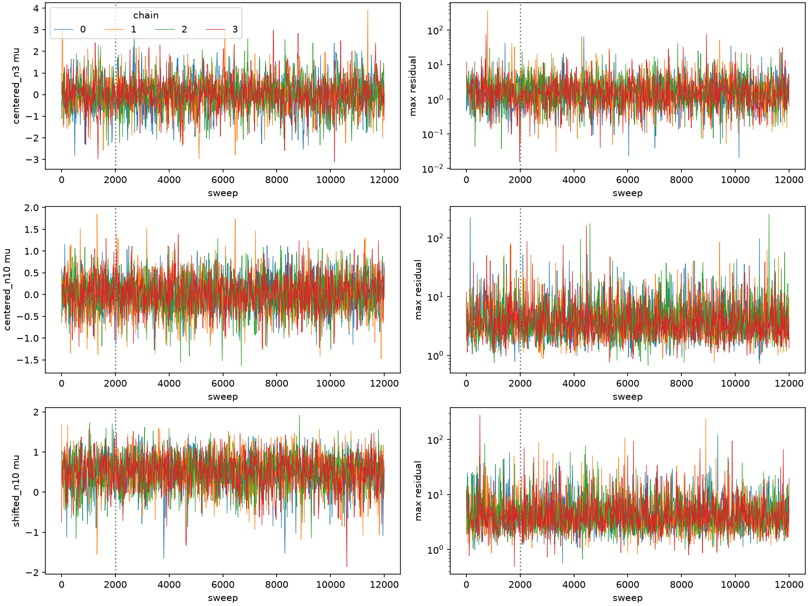

# Student selected-global-MLE pair Gibbs validation

Date: 2026-10-10. Scope: location only, known scale and shape; primary validation
is unit-scale Student **k=2**, n=3 and n=10. This follows the
[target audit](selected_mle_target_audit.md),
[reference validation](selected_mle_reference_validation.md),
[selector hardening](selected_mle_selector_hardening.md), and
[shifted reference follow-up](shifted_student_reference_followup.md).

**Outcome:** the separately implemented joint pair kernel has the required
selected-MLE invariant-target derivation and passes focused numerical checks.
All three cases pass the frozen central-posterior and latent-tail exploration
screens. In the shifted case, the mean is **0.49506 ± 0.00762** and latent-tail-6
probability **0.26535 ± 0.00666**, compared with saved weighted references
**0.49314 ± 0.00530** and **0.26925 ± 0.00389**. The rare parameter event mu>2
remains unresolved. Legacy Gibbs and all other existing model code are preserved.
Statements labelled **derivation** concern exact arithmetic on regular strata;
**implementation** and **numerical evidence** have the limits stated below.

## 1. Corrected pair kernel — derivation

For unit scale let y_i=x_i-t, psi(y)=y/(k+y²), C_t(x)=sum_i psi(y_i),
H_t(x)=sum_i (k-y_i²)/(k+y_i²)², and T be the hardened selected global
likelihood maximizer, choosing the smaller location only for exact ties.
With F_mu(x)=prod_i f_k(x_i-mu), the regular joint conditional target is

\[
\Pi_T(d\mu,dx)\ \propto\ \pi_0(\mu)
 \frac{F_\mu(x)}{\|\nabla_x C_t(x)\|}
 R_t(x)\,d\mu\,dH^{n-1}(x),\qquad
 R_t(x)=\mathbf1\{T(x)=t\}|H_t(x)|.
\]

Implicit differentiation gives grad T=grad C/H on a regular selected-root
branch. Thus 1/||grad T||=|H|/||grad C||; this is the curvature correction
relative to score conditioning. The absolute sum H is different from the
Euclidean norm of the component derivatives. A local curvature test does not
replace global selection. At a regular selected maximum H>0.

Fix all coordinates except i,j and set delta=-sum_{l≠i,j} psi(y_l), which is
the current pair sum on C=0. Write z=z_i, z_j=delta-z, b=1/(2 sqrt(k)), and

\[
 L=\max(-b,\delta-b),\qquad U=\min(b,\delta+b).
\]

On each regular inverse chart there are two finite branches for nonzero z:

\[
 y_{\rm inner}(z)=\frac{2kz}{1+\sqrt{1-4kz^2}},\qquad
 y_{\rm outer}(z)=\frac{1+\sqrt{1-4kz^2}}{2z}.
\]

At z=0 the only finite inverse is y=0. Exact folds are chart boundaries.
Let w_mu(z,b)=f_k(t+y_b(z)-mu)/|psi'(y_b(z))| and
q_mu(z)=sum_b w_mu(z,b). Changing both pair observations to score coordinates
and integrating the score constraint gives the conditional chart density

\[
 \pi(z,b_i,b_j\mid x_{-ij},\mu,t)
 \propto w_\mu(z,b_i)w_\mu(\delta-z,b_j)R_t(x)\,dz.
\]

There is no additional pair arc-length factor in this coordinate measure.
Propose z' from h(z'|z), put z_j'=delta-z', and independently propose both
branches with probabilities w_mu/q_mu at their proposed scores. The full
forward proposal is h(z'|z)[w_i'/q_i'][w_j'/q_j']; the reverse is
h(z|z')[w_i/q_i][w_j/q_j]. Consequently all four branch weights cancel:

\[
 \boxed{\log r=\log(q_i'q_j')-\log(q_iq_j)
 +\log h(z\mid z')-\log h(z'\mid z)
 +\log R_t(x')-\log R_t(x).}
\]

For the implemented fixed-interval truncated Gaussian random walk,
h(z'|z)=phi((z'-z)/sigma_z)/(sigma_z Z(z)), where
Z(z)=Phi((U-z)/sigma_z)-Phi((L-z)/sigma_z). Its symmetric Gaussian numerator
cancels, giving **log Z(z)-log Z(z')**. Applying min(1,r) to the entire pair
therefore satisfies pairwise detailed balance. An MLE-invalid proposal has
R=0 and is rejected; a numerically unresolved selection raises an exception.
Rejection retains both original branches and the full dataset.

Each accepted pair immediately changes x and its full-dataset curvature/global
indicator. The next pair uses that updated state, including for disjoint pairs:
R prevents their conditionals from factorizing. No correction is postponed to
a sweep endpoint. Random, state-independent pair schedules compose invariant
kernels. The full sweep also includes the ordinary parameter block
pi(mu|x) proportional to pi_0(mu)F_mu(x), since R does not depend on mu.
Invariance of this composition does not require the whole sweep to be reversible.
Global irreducibility is not proved here.

For fixed known scale s, y=(x-t)/s and the branch likelihood uses standardized
mu=(mu-t)/s. The scale constants in f_s(x-mu) dx/dz cancel; the score-curvature
correction differs only by a fixed factor. Unit-scale results below are not
broad validation over arbitrary scales.

One independent, read-only mathematical reviewer derived this cancellation and
reviewed the implementation. Its findings and caveats are saved in
[math_review.md](evidence/student_selected_mle_gibbs_2026-10-10/math_review.md).

## 2. Implementation and preservation

The new [models/loc_student_selected_mle.py](../../models/loc/student/selected_gibbs.py)
is separate from the legacy score-conditioned sampler. It exposes inspectable
inverse branches, branch probabilities, target correction, pair log ratio,
joint pair step, and run_gibbs. It requires an explicit selected-MLE-valid
initial_x and uses a local NumPy Generator with a recorded seed. Returned target,
estimator, kernel and numerical-policy metadata distinguish it from legacy output.

The shared Student log-density and ordinary parameter MH calculation are reused.
Branch weights and parameter updates use Numba where straightforward; pair
orchestration is deliberately transparent Python. The inverse calculation is
stable and has no legacy support-strip clipping, duplicate zero branch,
inverse-root clamp, or additive derivative floor. Both finite branches retain
their f/|psi'| weights. A state token prevents reuse of a stale correction.

Numerical errors have explicit reason codes. Fold/coalescence, unrepresentable
inverse branches, unresolved truncated-normal sampling, nonfinite weights,
score reconstruction failure, constraint failure, degenerate curvature, and
nonfinite parameter density abort rather than silently reject. Hardened selector
errors propagate unchanged. Positive curvature is evaluated in long double;
values unresolved relative to arithmetic error are not floored. Selector calls
retain its absolute 2e-13 root-accuracy request; selected-state checks use absolute
1e-10 release and score tolerances, separately from its exact-tie convention.

Two finite-precision qualifications matter. A tiny nonzero initializer score
defines a slightly displaced score level that pair moves preserve approximately;
initial residual and accumulated drift are recorded. Runtime acceptance uses
the intended proposed scores, while a guard checks their reconstruction in x;
independent tests recompute the ratio from actual x. This is not directed-rounding
certification of all inputs. The unchanged parameter MH block also retains its
existing uniform floor at 1e-12. Its effect is an inherited arithmetic
approximation, separate from the exact target derivation; the new wrapper checks
its current/proposed log densities for nonfinite values before calling it.

No existing sampler, selector, registry, KDE, location-scale model, or research
artifact was edited. The new experiment driver is
[validate_student_selected_mle_gibbs.py](../../scripts/validate_student_selected_mle_gibbs.py);
new regressions are in
[test_student_selected_mle_gibbs.py](../../tests/test_student_selected_mle_gibbs.py).
A starting inventory hashes 528 pre-existing source/document/evidence files;
the final preservation check is linked in section 7.

## 3. Numerical correctness checks

The focused suite passed **93 tests in 20.87 seconds**, comprising 28 new
selected-MLE tests and 65 existing branch-weight, legacy Gibbs and hardened
selector regressions. No final timeout or collection failure occurred. These
checks include:

- All finite inverses, the zero singleton, tiny nonzero scores, and analytic
  Student-density/inverse-Jacobian probabilities; the Cauchy special case and
  scores inside the legacy excluded fold strip.
- Independent full target/proposal flux calculations across all four proposed
  branch combinations, reverse-ratio antisymmetry, production-vs-inspected
  acceptance calculations, and full-pair rejection.
- Inferior strict local maxima excluded by global selection; singular curvature
  and injected selector/parameter failures propagated explicitly.
- Sequential full-state correction updates, stale-cache rejection, score and
  selected-global-MLE preservation, bad inputs, reproducible distinct chains,
  no global RNG mutation, and optional omission of stored latent chains.
- A small known-scale-2 chain control in addition to the three requested domains.

An initial suite had 24 passes and two failures from incorrect test fixtures:
the supposed invalid outer-branch proposal actually had selected MLE zero.
Small branch enumeration supplied a genuine invalid fixture (both positive outer
branches with proposed scores 0.05, 0.05); the global winner is near 19.85.
Those fixtures were corrected without changing the kernel to force rejection.
The original failed log remains [pytest_initial.log](evidence/student_selected_mle_gibbs_2026-10-10/pytest_initial.log).
The final log is [pytest_focused.log](evidence/student_selected_mle_gibbs_2026-10-10/pytest_focused.log).

## 4. Frozen reference and multichain design

The [configuration](evidence/student_selected_mle_gibbs_2026-10-10/config.json)
was frozen after separate 500-sweep cost/invariant pilots, excluded from final
summaries. Each case has four chains of 12,000 sweeps with 2,000 discarded:
40,000 retained states per case. sigma_z=0.1 and sigma_mu=0.45 are fixed.
Centered cases use prior N(0,2²); the shifted case uses t=1.25 and
N(-0.75,0.6²). Three valid initial datasets come from weighted-reference latent
maximum q10/q50/q90, and a fourth comes from normalizing a negative-outlier-12
dataset. Every chain has a different fixed seed; no all-at-release initialization
is used. The outlier starts also contain repeated central observations.

The fresh n=3 reference has 32,768 independent standardized datasets generated
with the hardened selector. The n=10 references use the already checked fresh
65,536+65,536 standardized banks from the shifted follow-up, with raw-file and
selector hashes verified. Centered n=10 weights are recomputed for its prior.
Whole-particle bootstrap uncertainty uses 200 repetitions for the fresh/reweighted
references. Every shifted summary is recomputed and checked against its saved
value to 1e-12; its original bootstrap uncertainty is carried forward unchanged.
No unchecked legacy cache or KDE is used.

The identity is mu=t-T(E), X=t+E-T(E), w=pi_0(mu). Its translation change of
variables has derivative one; **no curvature factor is added to these weighted
particles**. This independently constructed joint distribution is the numerical
benchmark. The previous independent prior-rejection check remains supporting
evidence for the shifted case; no new rejection campaign was needed here.

Limits were 120 seconds for the new bank, 180 seconds per chain, and external
process ceilings. The frozen exploration screens are R-hat<=1.01 and bulk/tail
ESS>=400 for mu, maximum residual, and its above-6 indicator. Summary differences
use a descriptive four-combined-MCSE screen. Chain MCSE is the larger of a
500-state batch estimate and between-chain summary SE; it is diagnostic rather
than a confidence guarantee. Split-half summaries, entry/exit counts, longest
tail runs, and raw weighted KS/Wasserstein distances are retained. No IID KS
p-values are used for correlated chains. A missing rare-event uncertainty is
not a passing comparison.

## 5. Reference comparisons and exploration

**Numerical evidence.** Reference importance ESS is 32,009 for n=3, 130,897
for centered n=10, and 14,747 for shifted n=10. There were zero new-bank or
chain numerical failures. The 528,000 pair proposals included 43 selective
exact-selector fallbacks (0.0081%), all resolved successfully. There were 1,830
global-selection rejections, 322,295 accepted pairs and 229,830 accepted
coordinate branch changes. These are mechanism counts, not convergence proofs.

Across every initialized/retained intermediate pair state, maximum reduced-score
residual was **1.81e-14**, initial residual at most **2.89e-16**, accumulated score
drift at most **1.78e-14**, and selected-MLE release residual at most **3.06e-13**.
Maximum inverse-score reconstruction error was **6.94e-17**. Minimum retained
curvature was **0.02286**, safely away from the singular boundary in these runs.
Checks apply to each accepted intermediate state; rejected states retain their
previous validated correction.

The separate rational polynomial oracle checked **72 reference/base datasets,
12 initializers, and 108 retained states**, including every chain's largest
retained latent excursion. All 192 checks succeeded. The largest production-vs-
oracle selected-location error was 8.88e-16; for retained states it was
3.07e-16, with maximum oracle release residual 1.47e-14 and float log-likelihood
gap 3.55e-15. Oracle objective bounds establish global selection on those
specific binary datasets; the float likelihood gaps are diagnostics rather than
sub-roundoff certificates. Not every sampled state received an independent oracle
check. Complete records are in the three `*_oracle_checks.json` files.

Values below are estimates ± one standard error. Reference errors are particle
bootstrap SE; Gibbs errors are the conservative diagnostic MCSE defined above.
The finite weighted bank is not exact truth. All screened summary differences
are within 1.79 combined MCSE; agreement is supported by the exploration checks.

| Case | Parameter summary | Weighted reference | Selected-MLE Gibbs |
|---|---|---:|---:|
| n=3, t=0 | Mean | -0.00342 ± 0.00401 | -0.01004 ± 0.01589 |
| | SD | 0.77107 ± 0.00320 | 0.75944 ± 0.01293 |
| | q05 | -1.24411 ± 0.01089 | -1.26697 ± 0.03632 |
| | q50 | -0.00958 ± 0.00451 | -0.00321 ± 0.01253 |
| | q95 | 1.23777 ± 0.00971 | 1.22816 ± 0.04074 |
| n=10, t=0 | Mean | -0.00122 ± 0.00119 | 0.00480 ± 0.00737 |
| | SD | 0.42048 ± 0.00088 | 0.42155 ± 0.00867 |
| | q05 | -0.68545 ± 0.00272 | -0.67823 ± 0.01977 |
| | q50 | -0.00029 ± 0.00140 | 0.00335 ± 0.00598 |
| | q95 | 0.68395 ± 0.00277 | 0.69306 ± 0.01341 |
| n=10, t=1.25 | Mean | 0.49314 ± 0.00530 | 0.49506 ± 0.00762 |
| | SD | 0.43861 ± 0.00552 | 0.43736 ± 0.00556 |
| | q05 | -0.26500 ± 0.02950 | -0.27218 ± 0.02039 |
| | q50 | 0.52972 ± 0.00406 | 0.52737 ± 0.00708 |
| | q95 | 1.14689 ± 0.00174 | 1.14452 ± 0.00773 |

Let M=max_i|X_i-t|.

| Case | Latent summary | Weighted reference | Selected-MLE Gibbs |
|---|---|---:|---:|
| n=3, t=0 | P(M>6) | 0.06688 ± 0.00136 | 0.06560 ± 0.00240 |
| | M median | 1.4679 ± 0.0090 | 1.5180 ± 0.0266 |
| | M q90 | 4.8176 ± 0.0454 | 4.7212 ± 0.0822 |
| | M q95 | 6.9766 ± 0.0799 | 7.0239 ± 0.1624 |
| n=10, t=0 | P(M>6) | 0.23440 ± 0.00109 | 0.23100 ± 0.00373 |
| | M median | 3.6004 ± 0.0089 | 3.5898 ± 0.0234 |
| | M q90 | 9.6733 ± 0.0447 | 9.6173 ± 0.1171 |
| | M q95 | 13.7997 ± 0.0912 | 14.1218 ± 0.2113 |
| n=10, t=1.25 | P(M>6) | 0.26925 ± 0.00389 | 0.26535 ± 0.00666 |
| | M median | 3.9542 ± 0.0266 | 3.9027 ± 0.0332 |
| | M q90 | 10.3487 ± 0.1305 | 10.3325 ± 0.1944 |
| | M q95 | 14.6804 ± 0.2770 | 14.8334 ± 0.2981 |

Parameter lower/upper tails at t±0.75 and latent P(M>3) are included in
[summary.csv](evidence/student_selected_mle_gibbs_2026-10-10/summary.csv).
The shifted lower-tail estimate is 0.47210 ± 0.00653 versus 0.47192 ± 0.00428;
P(M>3) is 0.67253 ± 0.00386 versus 0.67802 ± 0.00339. The shifted upper event
mu>2 has **zero observed events in 40,000 correlated draws** against reference
1.8881e-5 ± 3.7675e-7. Its chain MCSE/comparison is explicitly unavailable,
not zero and not a passed screen. No independent-binomial interval is attached
to correlated MCMC draws; the budget cannot settle this much rarer event.

| Case | Diagnostic | R-hat | Bulk ESS | Tail ESS |
|---|---|---:|---:|---:|
| n=3, t=0 | mu | 1.00073 | 2,173 | 2,548 |
| | M | 1.00161 | 9,544 | 6,619 |
| | 1{M>6} | 1.00010 | 11,691 | 11,691 |
| n=10, t=0 | mu | 1.00048 | 5,031 | 6,326 |
| | M | 1.00042 | 17,944 | 22,051 |
| | 1{M>6} | 1.00008 | 14,873 | 14,873 |
| n=10, t=1.25 | mu | 1.00082 | 3,692 | 4,039 |
| | M | 1.00033 | 14,032 | 21,009 |
| | 1{M>6} | 1.00056 | 15,729 | 15,729 |

R-hat uses the existing split/folded rank diagnostic, with raw split R-hat for
binary indicators; ESS uses the existing multichain initial-positive/monotone
autocorrelation calculation. These remain finite-run diagnostics, not proofs.

| Case | Chain mean range | Chain P(M>6) range | Tail entries per chain | Longest tail run |
|---|---:|---:|---:|---:|
| n=3, t=0 | -0.0382 to 0.0204 | 0.0610 to 0.0678 | 327–345 | 10–14 sweeps |
| n=10, t=0 | -0.0171 to 0.0145 | 0.2273 to 0.2337 | 1,323–1,374 | 9–12 sweeps |
| n=10, t=1.25 | 0.4862 to 0.5131 | 0.2526 to 0.2832 | 1,355–1,458 | 10–13 sweeps |

Every chain repeatedly enters and leaves M>6, including from its outlier start.
Retained maximum excursions range from 169 to 860 across chains, without the
multi-thousand-state tail residence seen in the previous affine study. Split-half
shifted tail estimates range from 0.2492 to 0.2920 and means from 0.4684 to
0.5187; these variations are retained in diagnostic MCSE, with split R-hat
comfortably below the frozen ceiling. They are not evidence of identical chains
or precision beyond the reported errors.

Descriptive parameter KS distances are 0.00633/0.00967/0.00708, and latent-maximum
KS distances 0.01745/0.00637/0.00988 for n=3/centered n=10/shifted n=10. The
corresponding Wasserstein distances are 0.01157/0.00645/0.00406 and
0.11224/0.08489/0.09622. Heavy-tail excursions influence Wasserstein estimates;
these are empirical distances rather than calibrated hypothesis tests.

Compared with the saved shifted affine evidence (latent-maximum R-hat 1.0776,
bulk ESS about 54; tail-indicator ESS about 119), the corrected Gibbs experiment
shows much stronger exploration for the declared latent statistics. The old
affine run used six longer chains and a partly different initializer set; this
is not a matched efficiency comparison or a validation of all latent functionals.
No mixing rescue run or changed threshold was used.



Full chain, split and movement records are in
[comparisons.json](evidence/student_selected_mle_gibbs_2026-10-10/comparisons.json).

## 6. Preliminary performance and limits

**Numerical evidence.** Three alternating-order, warmed 1,000-sweep timings per
case used one pinned CPU. Median wall cost is:

| Case | Legacy score Gibbs, µs/sweep | Affine, µs/sweep | Selected-MLE pair Gibbs, µs/sweep |
|---|---:|---:|---:|
| n=3, t=0 | 1.80 | 246.40 | 262.59 |
| n=10, t=0 | 7.32 | 309.59 | 1,330.32 |
| n=10, t=1.25 | 7.01 | 302.33 | 1,315.89 |

The transparent correction is about 146–188 times the fully compiled legacy
score sampler's cost per sweep. It is 1.07 times affine at n=3 and 4.30–4.35
times affine at n=10. A pair sweep makes floor(n/2) joint proposals with full
global-selection checks; affine makes one dataset proposal. Legacy samples a
different target. These are throughput comparisons, not matched ESS-per-second
or algorithmic-efficiency claims. Details are in
[benchmark.json](evidence/student_selected_mle_gibbs_2026-10-10/benchmark.json).
The 12 final chains used about 161 seconds total inside their run timers,
excluding imports, reference preparation, oracle checks and reporting.

The initial n=3 pilot included a roughly 3.6-second first-call/cache cost;
warmed final n=3 chains took about 3.5 seconds per 12,000 sweeps and n=10
chains 17.7–19.0 seconds. An analysis process spent substantial time waiting
on a Numba dependency file during import, then completed within its original
300-second ceiling. This delay was not a chain numerical failure or a timeout;
no additional simulation was run because of it.

**Remaining limits.** This supports the tested central posterior and latent
maximum/tail summaries on regular k=2, n=3/10 regions. It does not certify
every possible multimodal/extreme dataset, all latent functionals, other k/n,
all scales, or arbitrarily tight tolerances. It does not prove global
irreducibility. Exact folds and degenerate maxima need separate singular-stratum
treatment and currently raise; n<3 is explicitly unsupported. The hardened
selector's size, range, precision and fallback limits still apply. Slight initial
score offsets, accumulated floating-point drift, numerical selected-root tolerance,
and the inherited parameter uniform guard remain disclosed approximations.

The shifted parameter tail mu>2 is unresolved at this budget, despite good
central/latent diagnostics. Missing uncertainty cannot be repaired by assigning
a zero SE, and longer runs were not launched to force an event. Numba conversion
or cheaper selection screening would require a separate parity/correctness task;
the transparent kernel is presently the baseline.

## 7. Reproduction and decision

The [evidence directory](evidence/student_selected_mle_gibbs_2026-10-10/verification.json)
contains frozen configuration, source hashes, package versions, pilots, test logs,
bootstrap uncertainty, oracle records, all per-chain initial states/seeds/counters,
summaries, distances and traces. Raw new banks/chains are under ignored
`tmp/student_selected_mle_gibbs_20261010/`; their paths, sizes and SHA256 hashes
are in [artifact_manifest.json](evidence/student_selected_mle_gibbs_2026-10-10/artifact_manifest.json).
That manifest also identifies the two required existing validated reference banks.
Raw files must be carried with the report or regenerated; compact JSON/CSV alone
does not replace joint datasets. All 528 inventoried pre-existing files retained
their starting hashes, including legacy Gibbs/RATTLE, affine, selector, KDE and
historical evidence. Existing uncommitted changes were preserved as found.

Use the project virtual environment. SymPy 1.14.0 must be available for the oracle
and selective exact fallback; this run used the existing isolated dependency
directory. To regenerate, copy the configuration and change **both** new raw and
evidence directories; the driver refuses to overwrite banks or chains. Keep the
validated shifted-bank dependencies available with their recorded hashes.

```bash
export PYTHONPATH=/tmp/student-mle-oracle-deps-20261003
export OPENBLAS_NUM_THREADS=1
PYTEST_DISABLE_PLUGIN_AUTOLOAD=1 timeout 360s .venv/bin/python -m pytest tests/test_student_selected_mle_gibbs.py tests/test_student_inverse_branch_weights.py tests/test_student_gibbs_backends.py tests/test_student_location_mle_hardening.py -q --assert=plain
# Use your configuration copy in place of PATH below.
timeout 360s .venv/bin/python scripts/validate_student_selected_mle_gibbs.py --config PATH --phase references
timeout 900s .venv/bin/python scripts/validate_student_selected_mle_gibbs.py --config PATH --phase chains
timeout 300s .venv/bin/python scripts/validate_student_selected_mle_gibbs.py --config PATH --phase analyze
timeout 300s .venv/bin/python scripts/validate_student_selected_mle_gibbs.py --config PATH --phase benchmark
```

A small direct call requires a valid dispersed initializer:

```python
import numpy as np
from models.student_location_mle import global_mle
from models.loc_student_selected_mle import run_gibbs

e = np.random.default_rng(17).standard_t(2, 3)
x0 = e - global_mle(e, 2)
result = run_gibbs(18, 0.0, dict(
    n=3, k=2.0, num_iterations_T=500, initial_x=x0,
    initial_mu=0.0, prior_mean=0.0, prior_std=2.0,
    proposal_std_z=0.1, proposal_std_mu=0.45,
), verbose=False)
assert result['target'] == 'selected_global_student_location_mle'
```

**Decision:** the selected-MLE pair kernel is a mathematically justified,
numerically checked cross-check for the declared regular location-only cases.
All three central/latent comparison screens pass; no additional Gibbs mixing
improvement is indicated by this bounded evidence. A separately authorized
RATTLE correction can proceed against the raw weighted reference and this
transparent pair baseline, carrying forward the singular/numerical/rare-tail
limitations. Performance work and rarer-event validation remain separate tasks.
No RATTLE correction or repository cleanup was started.
